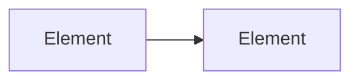

# View: <context | containers | components | runtime | data>

<!-- One C4 view. A diagram first, then a short table of the elements. Zoom: architecture covers C4 levels 1–2; a story's design.md covers 3–4. Whole-app views go in docs/architecture/views/. A feature view goes in docs/features/{slug}/ and is named {slug}.{type}.md, for example {slug}.runtime.md. -->

| Element | Responsibility | Notes |
|---|---|---|
