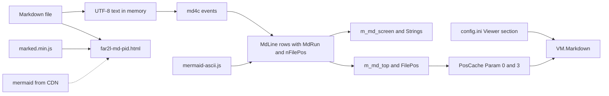

# View: Markdown data

The Markdown feature has no database. Its state is memory in the viewer, one cache field, two settings keys and one temp page for each browser view.

## In memory

| Element | Contents | Written by | Lifetime |
|---|---|---|---|
| Screen line, `MdLine` | Runs and `nFilePos` | `Builder`, `MarkdownDoc::Render` | Until the next render |
| Color run, `MdRun` | Text and an `MdRole` (body, h1, h2, h3, strong, link, code, quote, rule, art), never a color | `Builder` | With its line |
| Source offset, `nFilePos` | Byte offset of the start of the source line that holds the first source text of the row | `cb_text`, `Builder::flush` | With its line |
| Top row, `m_md_top` | Index into `Lines()`. `m_md_top_pos` is the `FilePos` of the last sync. | `SetMarkdownTop` | While the file is open |
| Screen rows, `m_md_screen`, `Strings` | The rows on screen. `Strings` holds the joined text for length and link scans. | `ReadStringMarkdown` | One redraw |
| Mermaid cache, `m_mermaid_cache` | Art rows, keyed by source hash and width. An empty entry is a failed fence. | `MarkdownDoc::Render` | One render pass |
| Token cache, `m_token_cache` | Fence tokens, keyed by the normalized language and a hash of the fence source. Survives `Invalidate(width)` and a resize (R38). | `MarkdownDoc::Render` | The viewer window's `MarkdownDoc`, across file switches |
| JS runtime, `g_engine` | One quickjs-ng runtime and context | `build_engine` | The process, or until a timeout |

**Offset rules.** Offsets never decrease down the doc. A row with no source text takes the offset of the row before it: the table separator, blank rows. All art rows of a fence take the fence offset. The hint row takes the offset of the last code row.

## Persisted

| Element | Contents | Written by | Read by |
|---|---|---|---|
| `Param[0]` | `FilePos`, the source offset of the top row | `SavePosCache` | `OpenFile` |
| `Param[3]` | 0 follows the rule, 1 is Markdown, 2 is plain | `MarkdownCacheParam` | `MarkdownStartMode` |
| `[Viewer] Markdown_Auto` | Default 1. Setting of the rule. | The settings dialog | `MarkdownRuleMode` |
| `[Viewer] Markdown` | Default 0. The last Shift-F4 mode. | `ProcessMarkdownMode` | Nothing |
| `settings/markdown-colors.ini`, section `[markdown]` | One key per role: `body`, `heading1`, `heading2`, `heading3`, `strong`, `link`, `code`, `quote`, `rule`, `art`, plus the four fence roles `token-keyword`, `token-string`, `token-comment`, `token-number`. A value is `foreground:#rrggbb`, `#rrggbb`, `#rgb`, `F_*`, or `@Name`. | The user, by hand. far2l never writes it. | `MdRunColor` in `far2l/src/markdown/`, re-read when the file mtime changes |

## Generated files

| File | Contents | Written by | Removed by |
|---|---|---|---|
| `${TMPDIR:-/tmp}/far2l-md-<pid>.html` | The escaped Markdown text, marked, the page script | `md-open.sh` | The operating system |

## Bundled and remote code

| Item | Version | Source | Used by |
|---|---|---|---|
| `far2l/src/markdown/md4c/` | 0.5.2, per the comment in `MarkdownRender.cpp` | Vendored. Only `md4c.c` is built. | `MarkdownDoc::Render` |
| `far2l/third_party/quickjs/` | quickjs-ng v0.14.0 | Vendored core, target `qjs`, no CLI or libc modules | `AsciiMermaid` |
| `far2l/bootstrap/mermaid-ascii.js` | `beautiful-mermaid` 1.1.3, about 84 KB | Committed output of `far2l/bootstrap/mermaid-ascii/build.sh` | `AsciiMermaid` |
| `far2l/bootstrap/marked.min.js` | marked v18.1.3 | Committed copy of the npm file | `md-open.sh` |
| mermaid | 12.3.0 | `cdn.jsdelivr.net`, with a `sha384` hash, never in the repo | The browser page |

## Environment

| Name | Effect |
|---|---|
| `FAR2L_MD_DEADLINE_MS` | Deadline of one fence, in ms |
| `FAR2L_MERMAID_ASCII_JS` | Path of the bundle. No other path is tried. |
| `MARKED_JS` | Path of `marked.min.js` for `md-open.sh` |
| `TMPDIR` | Folder of the temp page |
