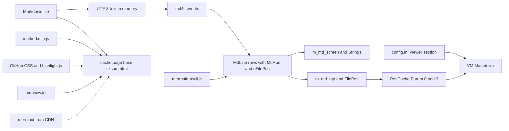

# View: Markdown data

The Markdown feature has no database. Its state is memory in the viewer, one cache field, two settings keys, one defaults file and one page file for each browser view.

## In memory

| Element | Contents | Written by | Lifetime |
|---|---|---|---|
| Screen line, `MdLine` | Runs, `nFilePos`, the row `tint` mark (0 = a tinted code-block row; the printer resolves the blend through `MdCodeTint`), and the `wrap` mark (true = the row may split into screen rows) | `Builder`, `MarkdownDoc::Render` | Until the next render |
| Color run, `MdRun` | Text and an `MdRole` (body, h1, h2, h3, strong, em, link, code, quote, listmark, rule, art, and the four fence token roles), never a color | `Builder` | With its line |
| Source offset, `nFilePos` | Byte offset of the start of the source line that holds the first source text of the row | `cb_text`, `Builder::flush` | With its line |
| Top row, `m_md_top` | Index into `Lines()`. `m_md_top_pos` is the `FilePos` of the last sync. | `SetMarkdownTop` | While the file is open |
| Screen rows, `m_md_screen`, `Strings` | The rows on screen. `Strings` holds the joined text for length and link scans. | `ReadStringMarkdown` | One redraw |
| Mermaid cache, `m_mermaid_cache` | Art rows, keyed by source hash and width. An empty entry is a failed fence. | `MarkdownDoc::Render` | One render pass |
| Token cache, `m_token_cache` | Fence token ranges, keyed by the normalized language, a hash of the fence source, and the scheme generation. Survives `Invalidate(width)` and a resize. | `MarkdownDoc::Render` | The viewer window's `MarkdownDoc`, across file switches |
| Colorer look cache | The ten `MdRegionLook` rows of one scheme generation, plus the 3:1 batch verdict keyed on (viewer background, generation) | `MdPalette.cpp`, mutex-guarded; refresh on a generation change, probed with a count-0 export call | The process, across file switches |
| JS runtime, `g_engine` | One quickjs-ng runtime and context | `build_engine` | The process, or until a timeout |

**Offset rules.** Offsets never decrease down the doc. A row with no source text takes the offset of the row before it: the table separator, blank rows. All art rows of a fence take the fence offset. The hint row takes the offset of the last code row.

**Cache rule.** `MarkdownDoc::Invalidate` drops the render, the mermaid art cache and the
code-block tint cache. It keeps the token cache, the Colorer look cache and the mermaid cache
key base. The token cache lives across the file's renders.

## Persisted

| Element | Contents | Written by | Read by |
|---|---|---|---|
| `Param[0]` | `FilePos`, the source offset of the top row | `SavePosCache` | `OpenFile` |
| `Param[3]` | 0 follows the rule, 1 is Markdown, 2 is plain | `MarkdownCacheParam` | `MarkdownStartMode` |
| `[Viewer] Markdown_Auto` | Default 1. Setting of the rule. | The settings dialog | `MarkdownRuleMode` |
| `[Viewer] Markdown_QuickViewWide` | Default 1. Quick view (Ctrl-Q) spans the full screen width for `.md` and `.markdown` files; the sibling panel keeps a strip of about 20 columns. Temporary: far2l.ini keeps the user's split and mode while the layout is applied. | The settings dialog | `QuickView::ShowFile` (apply, restore) |
| `[Viewer] Markdown` | Default 0. The last Shift-F4 mode. | `ProcessMarkdownMode` | Nothing |
| `settings/markdown-colors.ini`, section `[markdown]` | One key per role: `body`, `heading1`, `heading2`, `heading3`, `strong`, `em`, `link`, `code`, `quote`, `listmark`, `rule`, `art`, plus the four fence roles `token-keyword`, `token-string`, `token-comment`, `token-number`. The four fence keys apply on the V1-fallback path only; under V2 the fences take the scheme's rows, gated by the one verdict. A value is `foreground:#rrggbb`, `#rrggbb`, `#rgb`, `F_*`, or `@Name`. | The user, by hand. far2l never writes it. | `MdRunColor` in `far2l/src/markdown/`, re-read when the file mtime changes |
| `settings/md-view.ini`, section `[View]` | `width` (60, 70 or 80), `theme` (light, dark or auto), `browser` (auto, firefox, chrome, safari or a path). The tree keys are `tree` (on or off), `root` (dir or repo), `tree_depth` (1 to 12) and `tree_max_files` (1 to 2000). Defaults are 70, auto, auto, on, dir, 6 and 500. | The user, by hand, or `md-open.sh --init-config` for a sample when there is no file. far2l never writes it. | `md-open.sh` |
| Browser `localStorage`, keys `far2l-md-width`, `far2l-md-theme` and `far2l-md-tree` | The width, the theme and the open or closed tree panel that the reader chose on the page. Only an accepted word is used. | The page script. It is in the browser profile, not in the repo or in `~/.config`. | The page script. A page that a flag started ignores it. |

Order of use in the browser view: the saved page choice, then `md-view.ini`, then the built-in defaults. A flag replaces the file value, and a page that a flag started ignores the saved choice. The folder of `md-view.ini` is `${XDG_CONFIG_HOME:-$HOME/.config}/far2l/`.

## Generated files

| File | Contents | Written by | Removed by |
|---|---|---|---|
| `${XDG_CACHE_HOME:-$HOME/.cache}/far2l/md/<base>-<cksum>.html` | The escaped Markdown text of every page file, with the tree index. It holds marked, `highlight.js`, the four inlined styles, the page script, the key and the state of `md-view.ini`. The folder has mode 700 and the file has mode 600. `<cksum>` is the `cksum` of the real path of the file, so the name stays the same for each run. | `md-open.sh` | Nothing. The user can delete the folder. |
| `<page>.tmp.<pid>` in the folder of the page | The page while the script writes it. The script moves it over the page. | `md-open.sh` | `md-open.sh`, on an error or a signal |
| `${TMPDIR:-/tmp}/far2l-md-<pid>.html` | The same page, only if the cache folder cannot be used | `md-open.sh` | The operating system |
| The path of `--out` | The same page, written directly | `md-open.sh` | The user |

## Bundled and remote code

| Item | Version | Source | Used by |
|---|---|---|---|
| `far2l/src/markdown/md4c/` | 0.5.2, per the comment in `MarkdownRender.cpp` | Vendored. Only `md4c.c` is built. | `MarkdownDoc::Render` |
| `far2l/third_party/quickjs/` | quickjs-ng v0.14.0 | Vendored core, target `qjs`, no CLI or libc modules | `AsciiMermaid` |
| `far2l/bootstrap/mermaid-ascii.js` | `beautiful-mermaid` 1.1.3, about 84 KB | Committed output of `far2l/bootstrap/mermaid-ascii/build.sh` | `AsciiMermaid` |
| `far2l/bootstrap/marked.min.js` | marked v18.1.3 | Committed copy of the npm file | `md-open.sh` |
| `far2l/bootstrap/github-markdown-light.css`, `github-markdown-dark.css` | github-markdown-css 5.8.1 | The npm files, copied with no change. License in `github-markdown.LICENSE.md`. | `md-open.sh`, inlined |
| `far2l/bootstrap/highlight.min.js` | highlight.js 11.11.1 | Committed copy. License in `highlight.LICENSE.md`. | `md-open.sh`, inlined |
| `far2l/bootstrap/hljs-github.min.css`, `hljs-github-dark.min.css` | highlight.js 11.11.1, themes `github` and `github-dark` | Committed copies | `md-open.sh`, inlined |
| mermaid | 12.3.0 | `cdn.jsdelivr.net`, with a `sha384` hash (SRI) and `crossorigin="anonymous"`, never in the repo | The browser page |
| Colorer plugin exports | `ColorerTokenizeV1` (fence token classes). `ColorerTokenizeV2` (token ranges with the scheme's 24-bit and 4-bit foregrounds and a style word, plus a scheme generation). `ColorerRegionLookV1` (scheme colors and style for ten region names, plus a scheme generation) | The bundled Colorer plugin, module `colorer.far-plug-wide`, loaded with `FindPlugin` and `dlopen(RTLD_LAZY\|RTLD_NOLOAD)` | `MdColorer.{hpp,cpp}` |

The script inlines every vendored file, so the page policy has no new source. The script and these files install to one folder (see the browser spec).

## Environment

| Name | Effect |
|---|---|
| `FAR2L_MD_DEADLINE_MS` | Deadline of one fence, in ms |
| `FAR2L_MERMAID_ASCII_JS` | Path of the bundle. No other path is tried. |
| `MARKED_JS` | Path of `marked.min.js` for `md-open.sh` |
| `XDG_CACHE_HOME` | Base of the cache folder of the page. An absolute path. Else `$HOME/.cache`. |
| `XDG_CONFIG_HOME` | Base of the folder of `md-view.ini`. Else `$HOME/.config`. |
| `BROWSER` | One command name, used by `browser=auto` only |
| `TMPDIR` | Folder of the fallback page |
