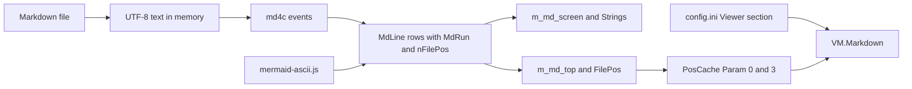

# View: Markdown data

The Markdown feature has no database. Its state is memory in the viewer, one cache field, two settings keys and one defaults file.

## In memory

| Element | Contents | Written by | Lifetime |
|---|---|---|---|
| Screen line, `MdLine` | Runs, `nFilePos`, the row `tint` mark (0 = a tinted code-block row; the printer resolves the blend through `MdCodeTint`), and the `wrap` mark (true = the row may split into screen rows) | `Builder`, `MarkdownDoc::Render` | Until the next render |
| Color run, `MdRun` | Text and an `MdRole` (body, h1, h2, h3, strong, em, link, code, quote, listmark, rule, art, and the four fence token roles), never a color | `Builder` | With its line |
| Source offset, `nFilePos` | Byte offset of the start of the source line that holds the first source text of the row | `cb_text`, `Builder::flush` | With its line |
| Top row, `m_md_top` | Index into `Lines()`. `m_md_top_pos` is the `FilePos` of the last sync. | `SetMarkdownTop` | While the file is open |
| Screen rows, `m_md_screen`, `Strings` | The rows on screen. `Strings` holds the joined text for length and link scans. | `ReadStringMarkdown` | One redraw |
| Mermaid cache, `m_mermaid_cache` | Art rows, keyed by source hash and width. An empty entry is a failed fence. | `MarkdownDoc::Render` | One render pass |
| Token cache, `m_token_cache` | Fence token ranges, keyed by the normalized language, a hash of the fence source, and the scheme generation. Survives `Invalidate(width)` and a resize. | `MarkdownDoc::Render` | The viewer window's `MarkdownDoc`, across file switches |
| Colorer look cache | The ten `MdRegionLook` rows of one scheme generation, plus the 3:1 batch verdict keyed on (viewer background, generation) | `MdPalette.cpp`, mutex-guarded; refresh on a generation change, probed with a count-0 export call | The process, across file switches |
| JS runtime, `g_engine` | One quickjs-ng runtime and context | `build_engine` | The process, or until a timeout |

**Offset rules.** Offsets never decrease down the doc. A row with no source text takes the offset of the row before it: the table separator, blank rows. All art rows of a fence take the fence offset.

**Cache rule.** `MarkdownDoc::Invalidate` drops the render, the mermaid art cache and the
code-block tint cache. It keeps the token cache, the Colorer look cache and the mermaid cache
key base. The token cache lives across the file's renders.

## Persisted

| Element | Contents | Written by | Read by |
|---|---|---|---|
| `Param[0]` | `FilePos`, the source offset of the top row | `SavePosCache` | `OpenFile` |
| `Param[3]` | 0 follows the rule, 1 is Markdown, 2 is plain | `MarkdownCacheParam` | `MarkdownStartMode` |
| `[Viewer] Markdown_Auto` | Default 1. Setting of the rule. | The settings dialog | `MarkdownRuleMode` |
| `[Viewer] Markdown_QuickViewWide` | Default 1. Quick view (Ctrl+Q) gets the screen minus a strip for `.md` and `.markdown` files. The file list is the strip. The layout is temporary. `ConfigOptSave` takes it back before it writes the setup. Thus `[Layout] WidthDecrement` and the saved list view mode stay the values of the user. | The user, by hand. No settings dialog entry. | `QuickView::ShowFile` (apply, restore) |
| `[Viewer] Markdown_QuickViewStripWidth` | Default 20. Columns of the file list strip beside a wide quick view. The strip is never wider than `ScrX - 10` columns. The clamp of `Opt.WidthDecrement` in `FilePanels::SetPanelPositions` makes it at least 11 columns. The strip is 21 columns when the list is on the right and the screen is 80 columns wide. | The user, by hand. No settings dialog entry. | `QuickView::ApplyMdWideLayout` |
| View mode 10 of the file list (`ViewSettingsRef` in `flmodes.cpp`) | One NAME column. It is not in the panel modes menu. `SavePanelModes` writes it as section `[Panel/ViewModes/Mode10]` in `panel.ini`. | `SavePanelModes` | `ApplyMdWideLayout` |
| Saved layout state on `QuickView` | `m_md_wide_applied`, `m_md_saved_view_mode`, `m_md_saved_width_decrement`. They live as long as the quick view object. They are never written to a file. | `ApplyMdWideLayout` | `RestoreMdWideLayout` |
| `[Viewer] Markdown` | Default 0. The last Shift-F4 mode. | `ProcessMarkdownMode` | Nothing |
| `settings/markdown-colors.ini`, section `[markdown]` | One key per role: `body`, `heading1`, `heading2`, `heading3`, `strong`, `em`, `link`, `code`, `quote`, `listmark`, `rule`, `art`, plus the four fence roles `token-keyword`, `token-string`, `token-comment`, `token-number`. The four fence keys apply on the V1-fallback path only; under V2 the fences take the scheme's rows, gated by the one verdict. A value is `foreground:#rrggbb`, `#rrggbb`, `#rgb`, `F_*`, or `@Name`. | The user, by hand. far2l never writes it. | `MdRunColor` in `far2l/src/markdown/`, re-read when the file mtime changes |

## Bundled code

| Item | Version | Source | Used by |
|---|---|---|---|
| `far2l/src/markdown/md4c/` | 0.5.2, per the comment in `MarkdownRender.cpp` | Vendored. Only `md4c.c` is built. | `MarkdownDoc::Render` |
| `far2l/third_party/quickjs/` | quickjs-ng v0.14.0 | Vendored core, target `qjs`, no CLI or libc modules | `AsciiMermaid` |
| `far2l/bootstrap/mermaid-ascii.js` | `beautiful-mermaid` 1.1.3, about 84 KB | Committed output of `far2l/bootstrap/mermaid-ascii/build.sh` | `AsciiMermaid` |
| Colorer plugin exports | `ColorerTokenizeV1` (fence token classes). `ColorerTokenizeV2` (token ranges with the scheme's 24-bit and 4-bit foregrounds and a style word, plus a scheme generation). `ColorerRegionLookV1` (scheme colors and style for ten region names, plus a scheme generation) | The bundled Colorer plugin, module `colorer.far-plug-wide`, loaded with `FindPlugin` and `dlopen(RTLD_LAZY\|RTLD_NOLOAD)` | `MdColorer.{hpp,cpp}` |

## Environment

| Name | Effect |
|---|---|
| `FAR2L_MD_DEADLINE_MS` | Deadline of one fence, in ms |
| `FAR2L_MERMAID_ASCII_JS` | Path of the bundle. No other path is tried. |
