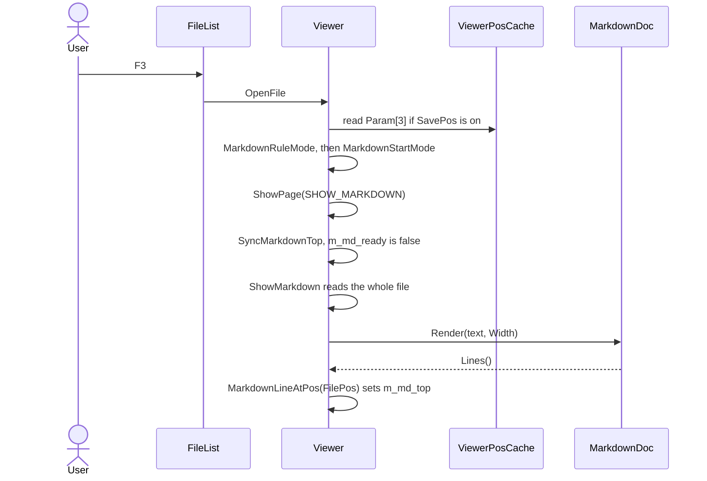
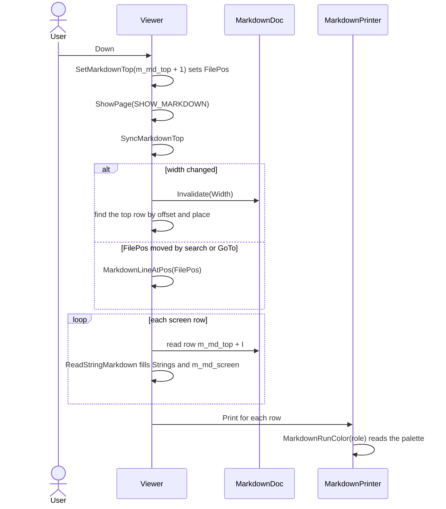
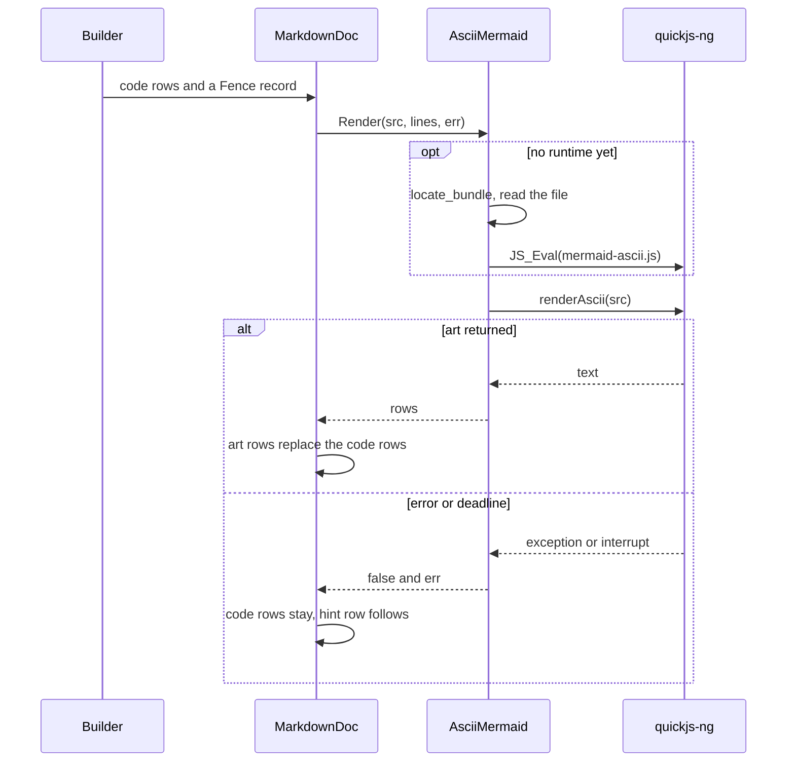
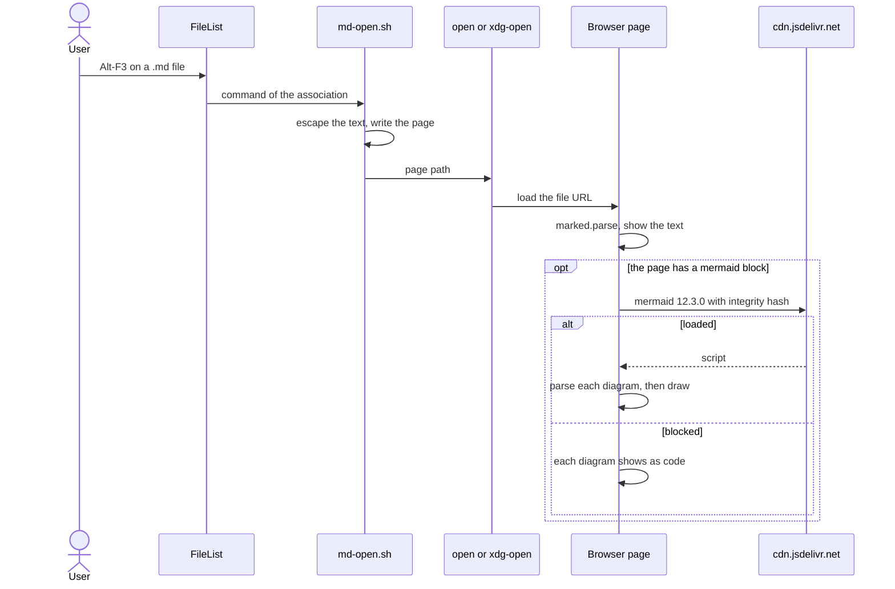

# View: Markdown runtime

Four flows matter. All F3 work runs on the UI thread. The browser flow is outside far2l after the command starts.

## Open a `.md` file in F3

| Step | Who | Note |
|---|---|---|
| Rule | `MarkdownRuleMode` | Name match and `Markdown_Auto`. The result stays in `m_md_rule`. |
| Start mode | `MarkdownStartMode` | Saved 1 or 2 wins. Else the rule applies. |
| Parse | `Render` | md4c events go to `Builder`, which fills `MdLine` rows. |
| Close | `SavePosCache` | `Param[3]` stores only a deviation from `m_md_rule`. |

## Render plus scroll

| Step | Who | Note |
|---|---|---|
| Move | `SetMarkdownTop` | Clamps the index and sets `FilePos` to the offset of that row. |
| Page | `MarkdownPage` | Moves by the screen height minus 1, up to `MarkdownMaxTop`. |
| Sync | `SyncMarkdownTop` | Three cases: new render, new width, or `FilePos` moved by other code. |
| Draw | `MarkdownPrinter::Print` | Ignores the text argument and draws the runs of `m_md_screen` in row order. |

## One mermaid fence to ASCII art

| Step | Who | Note |
|---|---|---|
| Collect | `cb_leave_block` | The fence body is the placeholder. |
| Bounds | `AsciiMermaid::Render` | A deadline, a 1 MB stack and a 128 MB limit on the one shared runtime. The deadline also covers a load of the bundle. |
| Timeout | `discard_engine` | Frees the runtime. The next call builds it again. |
| Splice | `MarkdownDoc::Render` | Runs in reverse order, so earlier indexes stay valid. |

## Open in the browser

| Step | Who | Note |
|---|---|---|
| Start | `ProcessLocalFileTypes` | Needs an entry that the user added by hand. |
| Write | `md-open.sh` | One page at `${TMPDIR:-/tmp}/far2l-md-<pid>.html`. |
| Show | The page script | The text shows before any network use. |
| Failure | `showCode` | A broken diagram shows its source and its error. Other diagrams still draw. |
