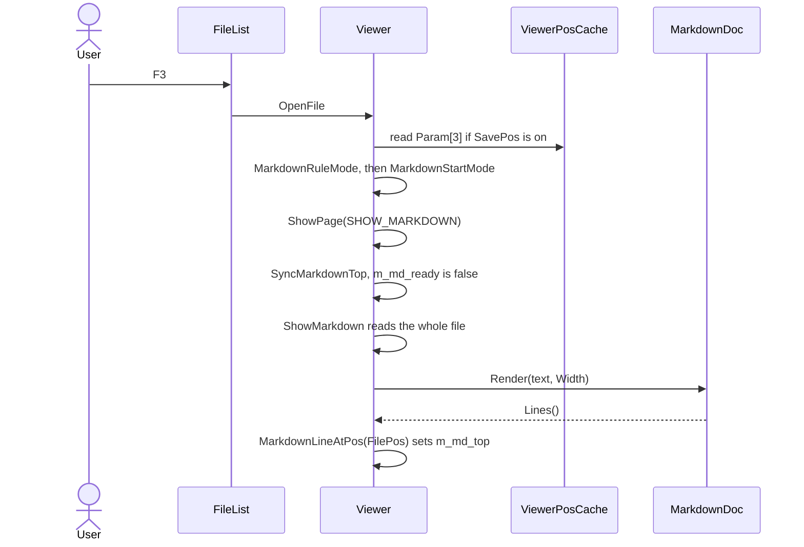
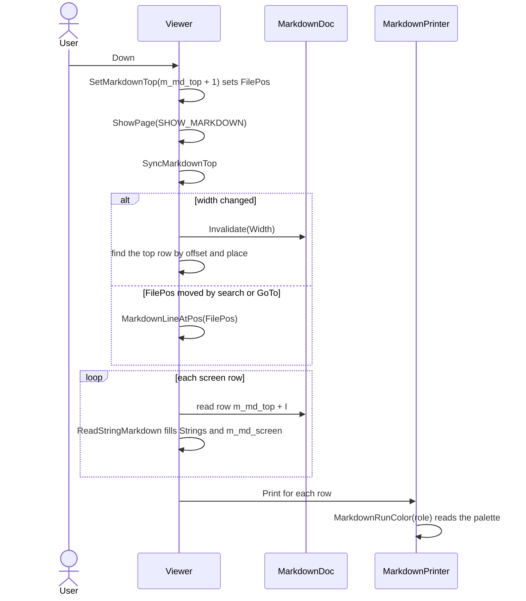
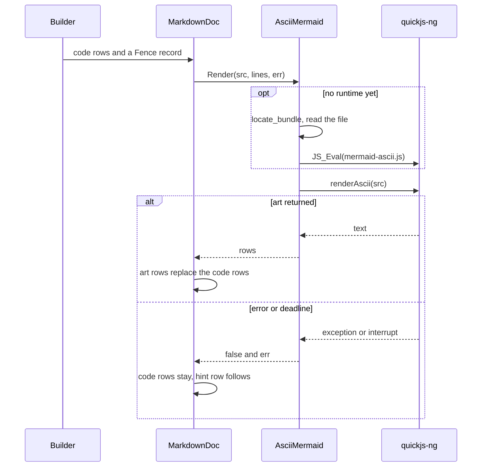
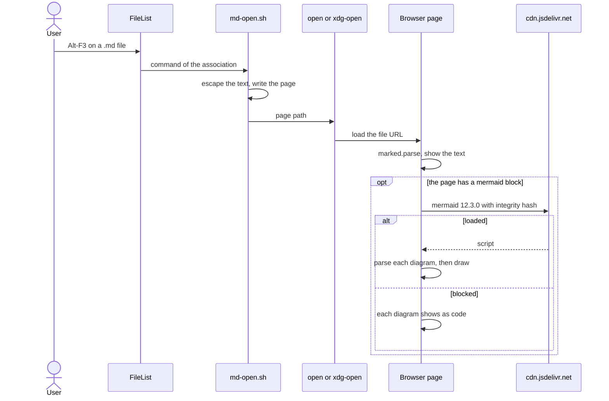

# View: Markdown runtime

Table layout bounds columns to the available viewer width and repeats borders and padding on continuation lines.
Four flows matter. All F3 work runs on the UI thread. The browser flow is outside far2l after the command starts.

## Open a `.md` file in F3

| Step | Who | Note |
|---|---|---|
| Rule | `MarkdownRuleMode` | Name match and `Markdown_Auto`. The result stays in `m_md_rule`. |
| Start mode | `MarkdownStartMode` | Saved 1 or 2 wins. Else the rule applies. |
| Parse | `Render` | md4c events go to `Builder`, which fills `MdLine` rows. |
| Close | `SavePosCache` | `Param[3]` stores only a deviation from `m_md_rule`. |

## Render plus scroll

| Step | Who | Note |
|---|---|---|
| Move | `SetMarkdownTop` | Clamps the index and sets `FilePos` to the offset of that row. |
| Page | `MarkdownPage` | Moves by the screen height minus 1, up to `MarkdownMaxTop`. |
| Sync | `SyncMarkdownTop` | Three cases: new render, new width, or `FilePos` moved by other code. |
| Draw | `MarkdownPrinter::Print` | Ignores the text argument and draws the runs of `m_md_screen` in row order. |

## Word wrap

F2 and Shift-F2 call `ProcessWrapMode`: it sets `VM.Wrap`, clears `m_md_ready`, and asks for
`SHOW_MARKDOWN_W`. The redraw calls `Render(text, Width, VM.Wrap)`. `Builder` marks text,
quote, list and table cell rows with `wrap` true; the layout code (fences, rules, art rows)
marks its rows with `wrap` false. `MarkdownDoc::Render` splits each marked row that is wider
than the width into screen rows at cell boundaries, with no trailing spaces. `SyncMarkdownTop`
keeps the same source row on screen: a width change finds the top row by source offset and
place. `ReadStringMarkdown` joins the runs and the row's `tint` into `m_md_screen`, so a
continuation row keeps the code-block tint of its logical row.
The table layout uses natural column widths while those widths fit the viewer. Otherwise, it allocates available content cells in proportion to each natural width. It assigns remaining cells by descending fractional remainder, with lower column indexes first on ties, then wraps cell content into bordered continuation rows.

| Step | Who | Note |
|---|---|---|
| Key | `ProcessKey` | `KEY_F2`/`SHIFT_F2` set the mode and pick `SHOW_MARKDOWN_W`. |
| Scroll | `KEY_RIGHT`, `KEY_LEFT`, `KEY_HOME`, `KEY_END` | Move `LeftPos` in both modes; arrows overlay the first and last column. |
| Split | `MarkdownDoc::Render` | Marks rows only; a marked row wider than the width becomes screen rows. |
| Keep top | `SyncMarkdownTop` | Finds the row of `FilePos`, then the row of that place in the new render. |
| Draw | `ReadStringMarkdown` | Carries the row's `tint` into `m_md_screen`. |

## One mermaid fence to ASCII art

| Step | Who | Note |
|---|---|---|
| Collect | `cb_leave_block` | The fence body is the placeholder. |
| Bounds | `AsciiMermaid::Render` | A deadline, a 1 MB stack and a 128 MB limit on the one shared runtime. The deadline also covers a load of the bundle. |
| Timeout | `discard_engine` | Frees the runtime. The next call builds it again. |
| Splice | `MarkdownDoc::Render` | Runs in reverse order, so earlier indexes stay valid. |

## Open in the browser

| Step | Who | Note |
|---|---|---|
| Start | `ProcessLocalFileTypes` | Needs an entry that the user added by hand. |
| Write | `md-open.sh` | One page at `${TMPDIR:-/tmp}/far2l-md-<pid>.html`. |
| Show | The page script | The text shows before any network use. |
| Failure | `showCode` | A broken diagram shows its source and its error. Other diagrams still draw. |

## Quick view takes the screen minus a strip for Markdown

`QuickView::ShowFile` gates on the extension (`.md`, `.markdown`, case-insensitive), on `Markdown_QuickViewWide` and on the path being a file, not a directory. On a pass it calls `QuickView::ApplyMdWideLayout`. The call saves the view mode of the sibling file list and `Opt.WidthDecrement` on the `QuickView` object. It sets the flag `m_md_wide_applied` first, because `SetScreenPosition` can redraw the panels and the redraw can reach `ShowFile` again. Then it sets the sibling to view mode 10 (one NAME column). It sets `Opt.WidthDecrement` so that the sibling gets `Markdown_QuickViewStripWidth` columns. Then it calls `FilePanels::SetScreenPosition`. The call comes before the `Viewer` is created, so the Markdown rows render at the wider width. The quick view panel has no `FullScreen` flag. With stacked panels (disposition 1) there is no strip, so nothing changes.

`QuickView::RestoreMdWideLayout` gives the saved values back and calls `SetScreenPosition`. These events call it:

| Event | Caller |
|---|---|
| Quick view shows a file that is not a gate file | `QuickView::ShowFile` |
| Quick view closes or the panel type changes | `FilePanels::ChangePanel`, before it reads the quick view position |
| Quick view hides (Ctrl+P, Ctrl+O) | `QuickView::Hide` |
| The setup is saved (Shift+F9, `AutoSaveSetup` at exit) | `ConfigOptSave`, after the Save setup dialog. It applies the layout again after the save and repaints. |

`QuickView::Show` applies the layout again when a hidden quick view shows a gate file. It does this only when the quick view holds an open `Viewer`. `ShowFile(nullptr)` leaves the old file name in `strCurFileName`, and `Show` must not apply the layout for that name. The destructor of `QuickView` does not restore the layout. At exit the sibling panel may be gone already.

Ctrl+Q moves focus into the quick view (`FilePanels::ProcessKey`, `KEY_CTRLQ`). Ctrl+Q from the quick view closes it and focuses the sibling panel, where quick view started. Ctrl+L and Ctrl+T keep the old focus rule. Tab focus switches do not touch the layout. Ctrl+Left, Ctrl+Right and Ctrl+Clear change `Opt.WidthDecrement` while the layout is on. A restore overwrites that change with the saved value. A full redraw repaints the sibling strip that the quick view box covers during the apply cycle.
