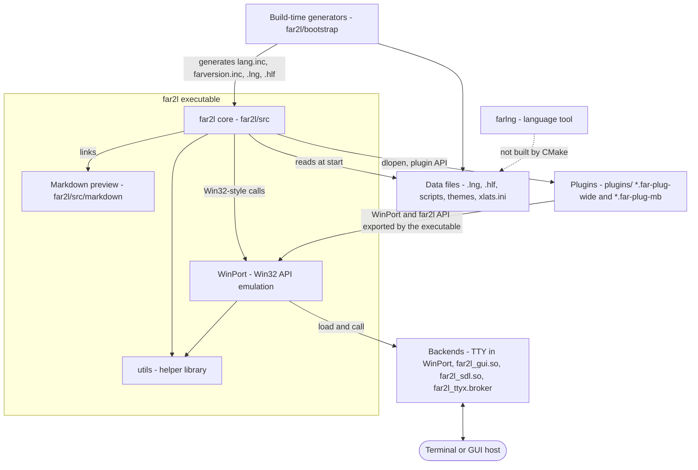

# View: Containers

far2l builds with CMake (root `CMakeLists.txt`). The result is one main program, some backend and plugin modules that it loads at run time, and data files. The rule in `HACKING.md` is: only the main executable links WinPort statically, and it exports the WinPort API to the plugins.

| Container | Responsibility | Key folders | Connects to |
|---|---|---|---|
| far2l core | The application: panels, viewer, editor, dialogs, menus, command line, file operations, macros, settings, plugin host. | `far2l/src` | Calls WinPort for all screen, key, file and thread work. Loads plugins. Reads `.lng` and `.hlf` files. |
| WinPort | Win32 API emulation (console, files, registry, clipboard, threads, string and code page functions). Holds the console model (`ConsoleOutput`, `ConsoleInput`). Picks and runs the backend. | `WinPort/src` (`API*.cpp`), `WinPort/wineguts` (code from Wine), `WinPort/src/sudo` | Is a static library inside the executable. Backends plug into it through `WinPort/src/Backend/Backend.h`. |
| Backends | Turn the console model into a real screen and real input. | `WinPort/src/Backend/TTY`, `.../WX`, `.../SDL`, `.../TTY/TTYX` | TTY code is part of the WinPort library. WX and SDL are `MODULE` libraries (`far2l_gui.so`, `far2l_sdl.so`) loaded with `dlopen`. `far2l_ttyx.broker` is a separate helper program. |
| Plugins | Extra features that use the FAR plugin API: panels for archives and remote hosts, editor tools, viewers. | `plugins/<name>`, API headers in `far2l/Include` and `far2l/far2sdk` | Each is a shared library loaded by the core. See the table below. |
| utils | Small cross-platform helpers: paths and profile folders, pipes and sockets, threads, UTF conversion, key-file reader, child process and pseudo terminal code, character classes. | `utils/src`, `utils/include` | Static library used by WinPort, the core, plugins and `farlng`. |
| Bootstrap and language | Generate headers, language files and help files from templates at build time. Hold the helper scripts and `xlats.ini`. | `far2l/bootstrap` (`scripts/*.pl`, `*.m4`, `*.sh`) | Output goes to the build folder (`bootstrap/lang.inc`, `farversion.inc`) and the install folder (`*.lng`, `*.hlf`, scripts). |
| farlng | Stand-alone tool with `generator`, `convertor` and `inserter` modes for language files. | `farlng/src` | Links `utils`. The root `CMakeLists.txt` does not add it, so a normal build does not make it. |
| themes | Color schemes. One folder per theme with `farcolors.ini`. | `themes/` | `themes/CMakeLists.txt` copies each folder to `themes/` next to the binary. |
| packaging | Version number and package recipes. | `packaging/version`, `packaging/debian`, `suse`, `osx`, `NixOS`, `buildroot` | `packaging/version` sets the version for CMake and for `farversion.inc`. |
| testing | Smoke tests. A Go program drives far2l in a pseudo terminal and runs JS test scripts. | `testing/src`, `testing/tests`, `testing/far2l-smoke-run.sh`, `testing/README.md` | Needs a build with `-DTESTING=yes`, which adds `TestController` to WinPort. CI runs it (`.github/workflows/build.yml`). |
| cmake | Find-modules and helper functions for CMake. | `cmake/modules`, `cmake/FuncCopyResources.cmake` | Used by the root `CMakeLists.txt` and plugin builds. |
| man | Man pages. | `man/far2l.1`, `man/ru` | Installed by `man/CMakeLists.txt`. |

## Core parts

| Part | Folder | What it holds |
|---|---|---|
| Frame manager and screen objects | `far2l/src/manager.cpp`, `frame.cpp`, `scrobj.cpp` (in `console/`) | `Manager` keeps a stack of `Frame` objects. `Manager::EnterMainLoop` runs them. |
| Panels | `far2l/src/panels`, `filepanels.cpp` | File list, tree, info and quick view panels. Plugin panels draw through the same classes (`flplugin.cpp`). |
| Viewer (F3) | `far2l/src/viewer.cpp`, `fileview.cpp` | `FileViewer` is a `Frame`. It owns a `Viewer`. |
| Editor (F4) | `far2l/src/editor.cpp`, `edit.cpp`, `fileedit.cpp` | `FileEditor` is a `Frame`. It owns an `Editor`. The `far2ledit` link starts it alone. |
| Markdown preview | `far2l/src/markdown` | One static library `far2l_md` (md4c parser, render code, ASCII Mermaid). The viewer calls it. Detail: [Markdown overview](../features/markdown/markdown.overview.md). |
| Console and UI base | `far2l/src/console`, `dialog.cpp`, `vmenu.cpp`, `hmenu.cpp`, `message.cpp` | Screen buffer, keyboard, colors, dialogs and menus. |
| Embedded terminal | `far2l/src/vt` | `VTShell`: the pseudo terminal and escape-sequence code for the command line. |
| Settings | `far2l/src/cfg` | Options (`config.cpp`, `ConfigOpt*.cpp`), language loader (`language.cpp`), legacy upgrade. |
| Plugin host | `far2l/src/plug` | `PluginManager`, `PluginW` (wide API) and `PluginA` (multi-byte API). |
| Macros | `far2l/src/macro` | Key-macro engine. Can be turned off with `FAR2MACRO`. |
| Helpers | `far2l/src/base`, `mix`, `hist`, `locale`, `bookmarks`, `filemask`, `shoco` | Strings, lists, path and string tools, history, code pages, bookmarks, file masks. |
| Third party | `far2l/third_party/quickjs` | QuickJS runtime. `far2l_md` links it to draw Mermaid. |

## Plugins by kind

Each plugin is a CMake option in the root `CMakeLists.txt` (`NOT DEFINED X OR X`, so on by default) unless the note says other.

| Kind | Plugins | Notes |
|---|---|---|
| Archives | `multiarc`, `arclite` | `multiarc` loads second-level format modules (`plugins/multiarc/src/formats`). README says `arclite` starts off until the user turns it on. |
| Remote and device panels | `NetRocks`, `adb`, `mtp`, `farftp` | `NetRocks` keeps one folder for each protocol family (SSH, SHELL, FTP, SMB, NFS, WebDAV, AWS) in `NetRocks/src/Protocol`. `farftp` is off unless `FARFTP` is set. `mtp` has a vendored libmtp and needs libusb. |
| Panel tools | `tmppanel`, `compare`, `OpenWith`, `filecase` | Temporary panel, folder compare, open with an external program. `filecase` changes the case of the selected file names (`FCTL_GETPANELINFO`, `filecvt.icpp`). |
| Editor text tools | `align`, `autowrap`, `truncate`, `editcase`, `edsort`, `SimpleIndent`, `jumpword`, `incsrch`, `editorcomp`, `drawline`, `transformer` | Small commands that work on the text in the editor. `transformer` runs external commands. |
| Editor display | `colorer`, `gitgutter` | Syntax highlighting. Git change marks. |
| Viewing and files | `hexitor`, `ImageViewer`, `inside` | Hex editor, image viewer, file structure browser (`inside/src/elf`). |
| Utilities | `calc`, `memo` | Calculator. Scratchpad with 10 pages. |
| Scripting | `python` | Off unless `PYTHON` is set. Python scripts add plugins (`plugins/python/configs`). |

## Bootstrap and main loop

1. `main` in `far2l/src/main.cpp` handles the special program names (`far2l_askpass`, `far2l_sudoapp`) and the `--libexec` mode. It sets the `-u` profile and finds the install path. Then it calls `WinPortMain` with `FarAppMain`.
2. `WinPortMain` (`WinPort/src/Backend/WinPortMain.cpp`) makes the console model objects. It reads the backend options (`--tty`, `--SDL`, `--x11`, `--wayland`, `--mortal`, `--nodetect`) and sets the clipboard backend. Without `--tty` it tries `dlopen` on `far2l_gui.so`, then `far2l_sdl.so`, and calls the exported `WinPortMainBackend`. If this fails, it uses the TTY backend (`WinPortMainTTY`). The backends check `FAR2L_BACKEND_ABI_VERSION`.
3. The backend calls `FarAppMain`. The GUI modules get it in the `app_main` field of `WinPortMainBackendArg` and run it on an application thread. The TTY backend calls it directly. `FarAppMain` reads the command line, loads options (`ConfigOptLoad`), starts the console (`InitConsole`), loads the language files (`Lang.Init`) and calls `MainProcess`.
4. `MainProcess` makes `ControlObject`, loads plugins (`Plugins.LoadPlugins`) and macros, opens the panels or only the editor or viewer, and calls `Manager::EnterMainLoop`. The loop reads keys through the console input (`GetInputRecord`) and sends them to the current `Frame`.

Where the data is:

| What | Where |
|---|---|
| Settings | `~/.config/far2l/settings/config.ini` (`CONFIG_INI`). `$XDG_CONFIG_HOME` and the `-u` option move it (`utils/src/InMy.cpp`). |
| Plugin state and cache | `~/.config/far2l/plugins/state.ini` |
| Bookmarks, macros, xlats | `settings/bookmarks.ini`, `settings/key_macros.ini`, `xlats.ini` in the config folder |
| Cache and temp files | `$XDG_CACHE_HOME/far2l` (default `~/.cache/far2l`) and a temp sub-folder named `far2l` |
| Language, help, scripts, plugins | Next to the binary, or `share/far2l` and `lib/far2l` in an installed layout (`TranslateInstallPath_*` in `utils/src/InstallPath.cpp`) |
| Plugin search folders | `<FARHOME>/Plugins`, its `lib` twin, and a personal path (`PluginManager`, `far2l/src/plug/plugins.cpp`) |

## Risks and open questions

- The comment in `far2l/CMakeLists.txt` calls `far2l_md` a "shared library", but the code makes it `STATIC`. The comment is wrong or the plan changed (unverified which).
- `farlng` is in the repository but no CMake file adds it. `far2l/bootstrap/CMakeLists.txt` runs `farlng.pl` through perl, so the build does not need the tool. Whether anything else uses it is unverified.
- The main loop description does not cover the TTY fork and revive mode (`TTYRevive`). Read `WinPortMain.cpp` for it.
- Dialog, editor and viewer detail is not in this view. The plugin API detail is in `HACKING.md`.
