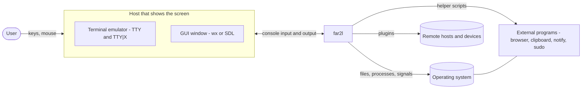

# View: Context

far2l is a Linux, macOS and BSD fork of FAR Manager v2. It is a two-panel file manager with an internal viewer, an editor, a command line and an embedded shell. One process runs the program. A host shows its screen and sends its input.

| Element | Responsibility | Notes |
|---|---|---|
| User | Works with files and text. Uses keys and mouse. | Starts far2l, or `far2ledit` for the editor only. |
| Terminal host (TTY) | Draws the screen as terminal escape sequences. Sends keys and mouse back. | Any terminal emulator, local or over SSH. The `--tty` option forces it. See "Compatible Terminals" in `README.md`. |
| TTY X extensions (TTY\|X, TTY\|Xi) | Give the TTY backend X11 access, for example to the clipboard. | Optional helper `far2l_ttyx.broker`. Built when X11 is present (`TTYX` and `TTYXI` options). The fallback order is in `README.md`. |
| GUI host | Shows far2l in its own window. | wxWidgets module `far2l_gui.so` (default, `USEWX`). SDL module `far2l_sdl.so` (`USESDL`, off by default). The `Mac` folders in both backends hold macOS code. |
| Operating system | Gives files, processes, pseudo terminals, sockets and the clipboard. | Linux first. macOS and BSD work but BSD is not tested often (`README.md`). |
| Remote hosts and devices | Hold files that the user opens as panels. | Reached only through plugins: NetRocks (SFTP, SCP, SHELL, FTP, FTPS, SMB, NFS, WebDAV, AWS S3), ADB, MTP, and optional FarFTP. |
| External programs | Do work that far2l does not do itself. | Shell scripts next to the binary (`open.sh`, `notify.sh`, `trash.sh`, `wslgclip.sh`), the system browser, an optional `clipboard` helper in the config folder, `sudo`. `md-open.sh` is in `Contents/Resources` or `share/far2l`, after `cmake --install` only. |

## Notes

- The host and the program are separate. far2l never draws pixels or escape sequences itself. See `containers.md` for the WinPort layer between them.
- The user settings are in `~/.config/far2l` (or `$XDG_CONFIG_HOME/far2l`). Option `-u` selects another profile folder. Detail is in `containers.md`.
- Terminal differences and the far2l terminal extensions are in `README.md`. This view does not repeat them.
