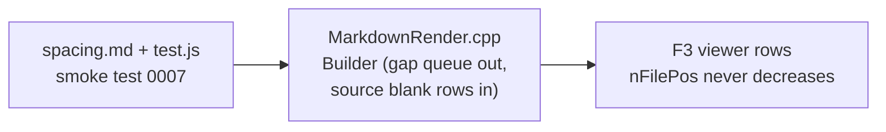

# Gate: markdown-blank-lines

_For the owner, who reads this instead of the code. One page per section. The model writes "Before build" before any task starts, and "At merge" at close-out; both go at the top of the PR._

## Before build

### What it builds

The F3 Markdown view stops inventing its own spacing and shows the empty lines of the file row for row, as F4 shows them. Each empty line of the source becomes exactly one blank row; two empty lines give two blank rows. The renderer adds no blank row of its own and removes none.

### Parts it touches

### Contracts, data and runtime

- The Spacing section of `markdown-viewer.spec.md` is replaced at close-out by the source-driven rule. This reverses the spacing half of the ruling of markdown-compact-layout (2026-11-06) under your ruling of 2026-11-08.
- No new settings keys, no new files, no palette, golden, browser-view or fence-content changes.
- Row positions: a blank row takes the file position of the row before it, so positions never decrease (ADR-003).

### Decisions the model made

| Decision | Alternative rejected | Why |
|---|---|---|
| Count blank rows at the first text of the next block, anchored at that text's line start | Count at `enter_block` | md4c gives no offset for a block before its text (ADR-002) |
| Scan the source for the lines before a thematic break (`---`) | Give `---` a text-anchored count | A `---` block gets no text callback, so it has no anchor |
| Count trailing empty lines after `md_parse` returns, in `Render()` | Emit them at the last block's leave | The last empty lines belong to no block |
| Keep the source-driven count out of `in_code` paths, but let fence text advance the anchor | Skip fence text in the anchor | A fence body is verbatim; its empty lines are already code rows, and the anchor must not count them twice |
| Anchor leading empty lines at offset 0 | Skip leading empties | Your ruling: empty lines show exactly as they are in F4 |
| Blank row keeps `row_lead()` of its list or quote | Drop the lead on blank rows | The spec keeps the lead rule; the visual context stays |
| A line with only spaces or tabs counts as empty | Only a zero-length line | A whitespace-only line reads as empty in F4 |
| A blank row holds no runs except the lead, no tint, no tokens | Copy other row fields | Nothing else is defined for a row with no content |
| Test rework keeps the C1-C7/R1-R7 comment tags | New anonymous checks | The tags keep the review history readable across the reversal |

### How you'll see it working

Open a file like `~/react-native-interview-questions.md` in F3: `### Q1` and `**Answer:**` now have the file's empty line between them, as F4 shows it. The check command (AGENTS.md, `BUILD=../far2l.markdown-blank-lines.build`) prints `check ok`.

### A fresh reader's paraphrase

**What this builds:** The F3 viewer's Markdown mode currently makes up its own vertical spacing between blocks; after this change it shows the file's empty lines exactly as they appear, like F4 does. Every empty line in the source becomes exactly one blank row in the viewer, no more, no less — the renderer neither adds blank rows of its own nor hides the source's ones. The change also reverses the spacing half of an earlier ruling (markdown-compact-layout, 2026-11-06) in the viewer spec at close-out.

**How the parts fit, per this page:** A fixture file (`spacing.md`) plus its test (`test.js`, smoke test 0007) drive and prove the behavior. The core work is in `MarkdownRender.cpp`: the renderer's old gap queue (its own invented spacing) is replaced by a source-driven count — blank rows are emitted by scanning the source's empty lines between blocks. The result lands in the F3 viewer's rows, where a blank row inherits the file position of the row above it so positions never decrease.

## At merge

### What was built

### Decisions changed during the build

### What the reviews caught

### Run it
