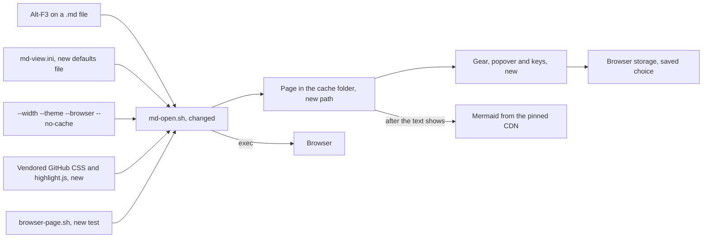

# Gate: markdown-browser-github-look

_For the owner, who reads this instead of the code. One page per section. The model writes "Before build" before any task starts, and "At merge" at close-out; both go at the top of the PR._

## Before build

### What it builds

The Alt-F3 browser page gets the GitHub look, highlighted code, and mermaid diagrams that follow the theme.
A small gear in the page corner sets the width (60, 70, 80 percent) and the theme (light, dark, auto). A defaults file sets the start values and the browser.

### Parts it touches

### Contracts, data and runtime

- `md-view.ini` in `${XDG_CONFIG_HOME:-$HOME/.config}/far2l/settings/`. Section `[View]`. Keys: `width=` (60, 70, 80), `theme=` (light, dark, auto), `browser=` (auto, firefox, chrome, safari, or an absolute path). A wrong value gives the default.
- New flags of `md-open.sh`: `--width N`, `--theme T`, `--browser B`, `--init-config`, `--no-cache`. A wrong `--width` or `--theme` value exits 2. `--print-association` also prints the config path and the accepted values.
- Page path: `${XDG_CACHE_HOME:-$HOME/.cache}/far2l/md/<base>-<crc>.html`. The folder is mode 700. `--out` still wins.
- Reuse rule: the old page is opened with no build if no input is newer and the key of the page (width, theme, forced) matches. Inputs: the Markdown file, the script, the vendored files, the ini file.
- Browser storage keys: `far2l-md-width` and `far2l-md-theme`. All access is in `try/catch`.
- Seven new vendored files in `far2l/bootstrap/`, installed with the script: two GitHub styles, `highlight.min.js`, two highlight themes, two license files. The CMake install list grows by these.
- The page policy (CSP) does not change. Inline scripts and styles are already allowed. The vendored files are inlined. Mermaid keeps the pinned URL and SRI hash.
- No C++ change. No change in `config.ini`.

### Decisions the model made

| Decision | Alternative rejected | Why |
|---|---|---|
| A separate `md-view.ini` (the owner's ruling) | Keys in `config.ini` | far2l rewrites `config.ini` on exit and drops keys it does not know. |
| `highlight.js` vendored and inlined | A CDN script | Code shows highlighted offline. The page policy stays as it is. |
| Page named `<base>-<crc>.html` from the real path | One fixed name, or the old `far2l-md-<pid>` name | A fixed name mixes two files. A pid name changes at each run, so storage and reuse fail. |
| Saved choice in `localStorage` in `try/catch`, plus a paste-into-ini line | Cookies, or a file written by the page | A page cannot write files. The paste line works when storage is blocked. |
| The browser starts with `exec "$browser" "$page"` and a checked name or path | `eval` or `sh -c` of a config string | A config value or a file name must never run as a command. |
| `auto` follows `prefers-color-scheme` for the page and for mermaid, and redraws on change | Read the theme once at load | The owner asked that a diagram follow the theme. |
| GitHub style from the `github-markdown-css` package | A hand-written stylesheet | It is the same look as GitHub and the owner named it. |
| Two files, `-light` and `-dark`, switched by the `media` attribute | The one `github-markdown.css`, which holds both | The one file picks its theme by the system only. It cannot honor a forced `light` or `dark`. |
| Two highlight themes, `github` and `github-dark` | One theme for both | Code must read well on a dark page and on a light page. |
| Page values come from a list of accepted words only | Escape the raw config value | A list gives no injection path. An escape can be wrong. |
| A flag run ignores the saved choice, and the page marks it `data-forced` | The saved choice always wins | "The flags win over the file" must hold on screen. |
| Reset button in the popover clears the saved choice | No way back to the ini values | The saved choice would hide an edit of `md-view.ini` for good. |
| `cksum` of the real path for the name, plus a safe file name part | `sha256sum` or `shasum` | They are not in POSIX. `cksum` is on every host. A collision is very rare and only reuses another page of the same name part. |
| The page is written to a temporary file, then moved | Write in place | A browser never reads a half page. |
| Gear hidden under 700 px, keys still work | Keep the gear over the text | At that width the column is full and the gear would cover text. |
| If the cache folder cannot be made, use the old temporary path with one stderr line | Fail | The viewer must still open. |
| Reset clears the saved choice and re-applies the ini values in place | A reload on Reset | A reload would lose an open popover and scroll position, and it needs no new code path. |
| Reuse also tracks the state of `md-view.ini` | Track the Markdown file only | An edited or deleted ini would show an old page that does not match the settings. |
| A saved page choice wins over the ini | The ini wins on each run | The reader chose it on the page. Reset is the way back to the ini. |

### How you'll see it working

Run `sh testing/markdown/browser-page.sh`. It prints `ok <case>` for each case and needs only `sh`.
Then run `sh far2l/bootstrap/md-open.sh --init-config`, and Alt-F3 on any `.md` file. You see the GitHub look. Click the gear, press `t` and `w`, and edit `md-view.ini` to change the start values.

### A fresh reader's paraphrase

_Pasted from the fresh read before the build._

**What this builds.** Opening a Markdown file in the browser view (Alt-F3) shows it in GitHub's style, with highlighted code blocks and mermaid diagrams that match the light or dark theme. A small gear on the page lets the reader pick the content width (60, 70 or 80 percent) and the theme (light, dark or auto). A defaults file sets the starting width, theme and browser.

**How the parts fit, per this page.** The Alt-F3 key runs the changed script `md-open.sh`. The script reads the new defaults file and the command-line flags, inlines the new vendored GitHub CSS and `highlight.js` files, and writes the page to a new path in the cache folder. The gear, popover and keys on the page change the look and save the choice in browser storage. Mermaid loads from a pinned CDN after the text appears. The script then starts the browser. A new test script, `browser-page.sh`, drives `md-open.sh` without a browser.

## At merge

### What was built

As planned. The Alt-F3 page has the GitHub look, highlighted code and mermaid that follows the theme. It has the gear, the popover and the keys `t`, `w` and `?`. It reads `md-view.ini` and the flags. The cache page keeps its name and is reused while no input changed. No C++ change and no change in the page policy.

### Decisions changed during the build

- The narrow rule is `html[data-width] #content { width: 100% }` in the `@media` block, because the plain `#content` rule loses on specificity.
- Under 700 px only the gear is hidden. The popover stays reachable with `?`.
- `--out` keeps the old direct write. Only the cache page and the TMPDIR fallback use a temporary file and `mv`.
- A `$BROWSER` value that starts with `-` is rejected.
- Each mermaid redraw has a 10 s timeout. A waiting batch is not added twice, and a redraw is skipped when the drawn theme is the same.
- The reuse rule reads the page key and the state of `md-view.ini` from the head of the page only. The Markdown text cannot fake them.

### What the reviews caught

- T1: the done check used `;` and `!` in one `sh -c`, so only the last command set the exit status. The check now guards each condition.
- T4: the popover was hidden under 700 px, so `?` did nothing there. Fixed in 7270c063b.
- T5: `--out` had lost the direct write and used a temporary file. Fixed in b2357ce12.
- Final review: no Critical or Important finding. The six Minor findings are parked in the close-out draft.

### Run it

From the repo root. Each step names what you should see.

1. `sh testing/markdown/browser-page.sh` prints `ok <case>` for each of the 42 cases.
2. The AGENTS.md check prints `check ok` and exits 0. It was run in full, alone, on this branch.
3. `sh far2l/bootstrap/md-open.sh --init-config` writes a sample `md-view.ini` and prints its path.
4. `sh far2l/bootstrap/md-open.sh --print-association` prints the entry for far2l: mask `*.md`, command `sh <path>/md-open.sh !.!`, the steps, the path of `md-view.ini` and the flags. Add the entry in far2l (F9, Commands, File associations).
5. Press Alt-F3 on a `.md` file, or run `sh far2l/bootstrap/md-open.sh <file.md>`.

Manual check in Firefox and Chrome (the rows of the page that the script cannot test). Use a file with a code fence, a table and two mermaid diagrams. Set `browser=firefox` or `browser=chrome` in `md-view.ini`, or use `--browser`.

- [ ] The page has the GitHub look, and the code fence is highlighted.
- [ ] The gear shows in the top-right corner, with low contrast, and does not cover the text at 60, 70 and 80.
- [ ] A click on the gear opens the popover. A click outside it, or Esc, closes it.
- [ ] The keys `t`, `w` and `?` change the theme, change the width and open the popover.
- [ ] The saved choice stays after a reload. Reset in the popover goes back to the `md-view.ini` values.
- [ ] A theme switch draws the mermaid diagrams again in the new theme.
- [ ] With `theme=auto`, a change of the system theme changes the page and the diagrams.
- [ ] The window under 700 px wide gives a full-width column and no gear. The key `?` still opens the popover.
- [ ] Print preview shows no gear and no popover.
- [ ] Run again with `--theme dark`: the page starts dark and ignores the saved choice.
- [ ] Block storage for the site, for example in a private window. The page works, and the popover shows a notice and the lines to paste into `md-view.ini`.
- [ ] Firefox storage spike: do the manual steps in `spike.md`. Open `a.html`, then `b.html`, from one folder. If `b.html` shows `before=value-from-a`, two local pages share the saved choice in Firefox. Chrome 156 does. The page does not depend on the result, so a `before=null` only means that each file keeps its own choice.
