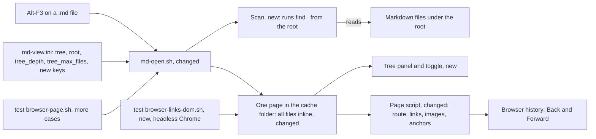

# Gate: markdown-browser-tree-panel

_For the owner, who reads this instead of the code. One page per section. The model writes "Before build" before any task starts, and "At merge" at close-out; both go at the top of the PR._

## Before build

### What it builds

Alt-F3 on a Markdown file opens the reading page with a file tree docked on the left, like the project panel of Zed. A click on a file in the tree, or on a link to such a file, shows that file in the same page. Back returns.
A link that leaves the tree shows as text with the note "not in this tree". `tree=off` gives the page of today.

### Parts it touches

Terms. The **opened file** is the file that Alt-F3 opens. The **root** is the folder that the tree shows: the real folder of the opened file, or with `root=repo` the nearest folder upward with `.git`. The **scan** is the new step in `md-open.sh` that lists the Markdown files under the root. The **encoded path** (`ENC`) is the path of a file under the root with each unsafe byte written as `%XX`. It is the only form of a name that the page holds. The **cap** is `tree_max_files`. The **one-file page** is the page of today, with no tree. "Story 1" is story markdown-browser-github-look. It made the page look, the gear (the settings button at the top right) and the cache page. T1 to T4 are the tasks in `plan.md`. The exact rules are in `spec.md`.

### Contracts, data and runtime

- New `md-view.ini` keys in `[View]`: `tree=on|off` (default `on`), `root=dir|repo` (default `dir`), `tree_depth` (default 6, ceiling 12), `tree_max_files` (default 500, ceiling 2000). A value over a ceiling gives the ceiling.
- New flags: `--tree on|off`, and `--list-tree <file.md>`, which prints the root and the tree and writes no page.
- Fixed limits: 1 MiB for one file, 8 MiB of Markdown text in the page. A file over a limit is in the tree, marked, and shows a note instead of its text. The opened file is always in the page. It is added after the cap, and the cap note does not count it.
- Scan: skips `.git`, `node_modules`, hidden folders and hidden files, names with control bytes, and every symlink. Order: shallow files first, then by name. The panel says "Showing the first N files." at the cap.
- Page: every file of the tree inline as `<script type="text/markdown" data-path="ENC">`, a tree index, and `data-tree`, `data-root`, `data-files`, `data-cap` on `html`. Route `#/ENC` or `#/ENC#heading`. Headings get the id `user-content-<slug>`, so `#heading` links work now.
- Panel: 260 px on the left, the root name at the top, folders as `details`, the current file marked, toggle button `#md-tree-toggle` and key `b`. Saved state in `localStorage` key `far2l-md-tree`. Hidden under 700 px and in print. The width setting applies to the space right of the panel.
- Cache: the page key adds `tr`, `r`, `d` and `n`. A head comment holds a `cksum` of the tree list. In tree mode the scan runs on every call. The page is reused only if the tree list is the same and no file is newer than the page.
- No new page policy source, no new vendored file, no C++ change.

### Decisions the model made

| Decision | Alternative rejected | Why |
|---|---|---|
| One page with all files inline. **Owner: confirm.** | A small page plus one `.js` chunk per file and an `index.js`, loaded with `script src`, rebuilt by file state | The page policy blocks `script src` from `file:`. Chunks need `file:` in `script-src`, a new source. A chunk is code that runs, so an escape bug in it runs the text. Inline text is data that never runs. |
| A full rebuild in one `awk` pass when anything changed | A cache of escaped pieces per file | One `awk` process reads 500 files fast. A piece cache adds files, state and code to the cache folder. The T4 measure checks this. |
| The scan uses `find`, `sort` and `cksum`. **Owner: the old hard stop named only `sh`, `sed`, `awk`, `grep`.** | A folder walk in `sh` with globs | A walk in `sh` is slow and must handle hidden names, links and depth by hand. `find` with POSIX options does it in one call, as a probe on this Mac showed. |
| Ceilings 12 for depth and 2000 for files, and fixed limits of 1 MiB per file and 8 MiB per page. **Owner: confirm the numbers.** | No ceiling, or byte limits in the ini | An ini typo must not make a 100 MB page. Two keys are what the owner asked for. |
| A root equal to `$HOME` or `/` gives the page of today, with a note | Scan the home folder | A note in the home folder would scan all of `~/Library` to depth 6 on each Alt-F3. |
| `root=repo` stops after `$HOME`, and never checks `/` | Walk to `/` | The owner said "stop at `$HOME` or `/`". |
| Only Markdown files in the tree. Folders with no Markdown file are not shown. | All files | A click on a non-Markdown file has nothing to show in the page. |
| Hidden files are skipped too, not only hidden folders | Show `.notes.md` | One rule for every name that starts with `.`. |
| Toggle key `b` (as Ctrl-B in Zed and VS Code) | `f`, `[`, `\` | `b` is free, near the sidebar habit, and not `t`, `w` or `?`. |
| Shallow files first at the cap, then by byte order | `find` order | The cap must keep the files near the root, and the order must be the same on each run. |
| Folders are `details` elements. The folders of the current file are open. | All folders open | 500 files in open folders is a long list. `details` works with the keyboard and needs no script. |
| A link out of the root, and a `file:` link, become text with the note | Keep today's raw `file://` link | The owner's rule. It also stops a page from opening a file outside the tree. |
| A link to a big or cut file goes to it and shows a note | Text with a note | The file is in the tree, so the link is not wrong. |
| `%XX` is decoded once, then `..` is checked | Check, then decode | `%2e%2e/` must not pass the root check. |
| The page holds a name only as an encoded path, and shows it decoded through `textContent` | Escape the raw name for HTML | The encoded form cannot break an attribute or a comment. |
| Heading ids have the prefix `user-content-` (as GitHub) | The bare slug | A heading named `mermaid` would take a global name of the page. |
| Tree and bundle links are real `href` values to `<page>#/ENC` | Catch clicks in the script | Back, Forward, a new tab and copy-link work with no extra code. |
| Links and images are fixed in a `template` before they enter the page | Change `<base href>` for each file | An image in a template does not load, so no request goes to the wrong folder. |
| One file shows at a time, rendered on each route | All files rendered in hidden sections | Mermaid cannot draw in a hidden section, and 500 files at once is slow. |
| One page per opened file (story 1 name) | One page per root, with the file in the hash | Openers get a path, and the hash of a `file://` URL is not kept by all of them. Not tested. |
| In tree mode the scan runs on every call. Only the build is skipped on a reuse. | Reuse with no scan | Only a scan sees an added file. |
| `--list-tree` flag | Test only through the page text | A test can check the scan alone, and the reader can see what the tree holds. |
| Heading ids and same-file anchors work in the one-file page too. This is a change to the page of story 1. **Owner: confirm at merge.** | Leave the one-file page exactly as story 1 | It fixes a parked defect (`#anchor` links go to the folder) with the same code. The one-file page has no panel CSS and no panel markup. |
| Linux scan not run. **Owner: decide at merge.** T1 proves the `find` line with POSIX primaries on this Mac only. If Linux cannot be run, the task report says so. | Claim that the scan works on Linux | A claim with no run is not proof. The owner decides at merge: run it on Linux, or accept the risk. |

### How you'll see it working

1. `sh testing/markdown/browser-page.sh` prints `ok` for each case, the new `tree_*`, `root_*`, `scan_*` and `cache_tree_*` cases too.
2. `sh testing/markdown/browser-links-dom.sh` prints `ok` for each `dom_*` case.
3. `sh far2l/bootstrap/md-open.sh --list-tree <notes>/index.md` prints the root and the tree.
4. Alt-F3 on a note in a folder of notes. The tree is on the left. Click a file, click a link, press Back, press Forward, press `b`. Reload the page and check that the saved open or closed state stays. Click a file in the tree and check that the focus is in the reading pane. Make the window narrower than 700 px and check that the panel is hidden. Click a link with a `#heading` and check that the page scrolls to that heading. Do this in both Firefox and Chrome.

### A fresh reader's paraphrase

_Pasted from the fresh read before the build._

**What this builds.** Alt-F3 on a Markdown file opens the reading page. It has a file tree docked on the left, like the project panel of Zed. A click on a file in the tree shows that file in the same page. A click on a link to such a file does the same. Back returns. A link that leaves the tree shows as text with the note "not in this tree". `tree=off` gives the page of today.

**How the parts fit, per this page.** Alt-F3 runs the changed `md-open.sh`, which reads the new settings in `md-view.ini`. It runs a new scan, one `find` from the root, over the Markdown files under that root. The scan feeds one cache page that holds every file of the tree inline, with a tree index. The page gets the new tree panel and toggle, and a changed page script. The script handles routing, links, images and anchors. So Back and Forward work through browser history. Two test scripts check it: the extended `browser-page.sh` and the new `browser-links-dom.sh`, which uses headless Chrome.

## At merge

Owner gate G4: the owner said "merge it" on 2026-11-07 and PR #16 was merged into `next/2.9.1-ovr.1` as `019c8ffda`. The heading ids in the one-file page are in, as listed above. The Linux scan is still not run; the `find` line is proven on this Mac only.

### What was built

Alt-F3 on a Markdown file now opens the reading page of the root. It holds the opened file and the other Markdown files under the root, in one page. A file tree is docked on the left. The panel has the root name, `details` folders and one link per file. The shown file is marked, and its folders are open. The toggle button and the key `b` open and close the panel, and the browser keeps the state after a reload. A click in the tree, or on a link in the text, shows that file at the same address, so Back and Forward work. A link that leaves the root becomes text with `not in this tree`. A file over 1 MiB or over the page limit stays in the tree and shows a note. `tree=off`, `--tree off` or a root of `$HOME` or `/` gives the page of one file, as story 1 made it.

New keys in `md-view.ini`: `tree`, `root`, `tree_depth`, `tree_max_files`. New flags: `--tree on|off` and `--list-tree`.

### Decisions changed during the build

1. The one-file page tests name `--tree off`. Tree mode is the default, so the one-file page is now a mode, not the only page. This keeps the assertions of story 1 on the page they describe.
2. The panel CSS and markup are written only in tree mode. The one-file page is byte-for-byte the page of story 1.
3. Each name of the tree is an encoded path in an attribute and a decoded text node. A name never becomes an element or an attribute name.
4. A saved panel state cannot open a panel that `tree=off` removed.

### What the reviews caught

- T1 Important: a folder name that ends in a newline gave the tree and the text of a sibling folder. The `pwd -P` result lost the newline. A sentinel at the end of each `pwd -P` keeps it, and a test covers it.
- T2 Critical: the escape function was quadratic. One file with a long line of `\` stopped the build. It now runs one linear `sed` pass. A test with a 400 KB line covers it.
- T2 Minor: the reuse step of the scan passes when `find` cannot stat the page. Accepted; the `cksum` line still guards the reuse.
- T1 Minor: two test assertions prove less than their names say. Accepted as polish.
- Final review Important: in one-file mode a relative link lost its `href` and got the tree note. The page of story 1 must keep its links, so `applyLink` now leaves them as story 1 made them. A new DOM case covers it.

The review yield is in `closeout.md`.

### Run it

1. Add the Alt-F3 association one time: `sh far2l/bootstrap/md-open.sh --print-association`.
2. Open a folder of notes with Alt-F3 on one file. The tree is on the left. Click a file, click a link, press Back, press Forward, press `b`.
3. Reload: the panel state stays. Narrow the window below 700 px: the panel is hidden.
4. Set `width=60` and `theme=dark` in `md-view.ini`: the text column takes 60 percent of the space right of the panel.
5. Check the manual items in `closeout.md` in Firefox and Chrome.
