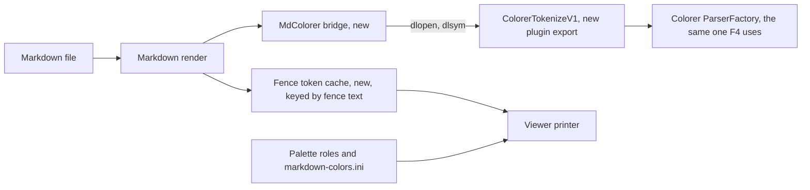

# Gate: markdown-code-highlight

_For the owner, who reads this instead of the code. One page per section. The model writes "Before build" before any task starts, and "At merge" at close-out; both go at the top of the PR._

## Before build

### What it builds

A code block in the F3 Markdown view gets the same syntax colors as the F4 editor.
Both take their tokens from Colorer, the syntax-coloring plugin that ships with far2l and that F4 already uses. Its `ParserFactory` reads the language scheme files and returns the token spans of a line.

### Parts it touches



### Contracts, data and runtime

- New plugin export, one function, optional: `ColorerTokenizeV1(lang, lines, count, emit, ctx, deadline_ms)`. It returns 0 (all lines), 1 (stopped at the deadline), -1 (no editor set yet), -2 (unknown language) or -3 (a Colorer error). It gives token classes, not colors: keyword 1, string 2, comment 3, number 4.
- New core bridge `far2l/src/markdown/MdColorer`: finds the plugin once per process. A test can install a fake token source, so the token code is testable with no plugin.
- New data on a code line: an index into a token group of the document. A token group holds compact spans (`start`, `end`, class), not text, in the cell coordinates of that line's code run. The cache key is the fence language plus a hash of the fence text, in the form of the existing mermaid cache, so a resize does not parse again.
- Four new palette roles: `token-keyword`, `token-string`, `token-comment`, `token-number`, each with an RGB default, a 256 index, a 16-color fallback, and a key in `settings/markdown-colors.ini`. The contrast rule and the user file work as they do for the other roles.
- Limits, all per render: 1000 characters of each source line, 400 lines and 64 KB per fence, 40 ms of time for all fences together. A fence that hits a limit shows the plain code color where it stopped.
- ADR-008 records the route: the core reaches Colorer through one optional plugin export, with the fallback that no plugin means the plain code color.
- Words: md4c is the Markdown parser the viewer already uses; a palette entry is a named color slot of the far2l console, for example `COL_HELPHIGHLIGHTTEXT`; `dlopen` asks the operating system for a module that is already in the process.

### Decisions the model made

| Decision | Alternative rejected | Why |
|---|---|---|
| Keep the token spans per fence, in a cache keyed by the fence language and the hash of its text | Parse on every redraw, or store one text run per token | A resize re-renders the layout; the cache makes it free. 20 000 lines of JavaScript give 320 000 regions, and a text run per token costs a string each. The document caches mermaid fences the same way today. |
| Split the code run into colored parts when the printer draws | Let the render emit one `MdRun` per token | Keeps the run list small, and keeps the change in `ViewerPrinter.cpp` under 40 lines. |
| One 40 ms time budget for all fences in one render | One budget per fence | A file with many fences adds the per-fence budgets. A measured 1 MB python line took 9.9 s with no limit and 52 ms with a 50 ms limit. |
| Caps of 400 lines and 64 KB per fence | No cap, or 20 000 lines | The rows past a cap are off screen, and the cap bounds the memory of the span list. |
| `dlopen` with `RTLD_NOLOAD` on the loaded plugin module, then `dlsym` | `CallPlugin` with a custom `OpenFrom` and a request struct; or a one-line change to `plclass.hpp` | One exported function, no change to `far2l/src/plug/`, and the plugin stays the owner of the parser factory. |
| Four roles, all on `COL_HELPHIGHLIGHTTEXT` when the contrast fails | A palette entry per role | ADR-004 already gives code that entry, so a 16-color theme reads the fence as code with a little structure. |
| A new smoke test that loads the colorer plugin, plus a C++ driver test with a fake source | Only the smoke test, or only the driver | The driver checks the role mapping and the limits with no plugin; the smoke test proves the real plugin path. |
| Prove both color paths in the new smoke test, with `ReadCell` | A driver-only check plus a hand check in a terminal | The harness already reads a cell's 24-bit color and its 16-color index, and `0007-view-file-markdown` uses both, so the RGB path needs no new probe. |
| Only fenced blocks, with a language name | Indented code and HTML blocks too | They carry no language name, so Colorer has nothing to pick. |

### How you'll see it working

Open a Markdown file with a fenced block in the new build: `../far2l.markdown-code-highlight.build/install/far2l.app/Contents/MacOS/far2l`, F3 on a file with a ```` ```python ```` block. Keywords, strings, comments and numbers get four colors, and a fence with no language name keeps today's code color. The machine runs the same check in the test `000c-view-md-highlight`.

### A fresh reader's paraphrase

**What this builds.** In far2l's F3 markdown viewer, a fenced code block that names a language gets the same syntax colors the F4 editor shows. The colors come from Colorer, the syntax-coloring plugin F4 already uses: a new optional plugin export asks Colorer's ParserFactory for each fence line's token classes (keyword, string, comment, number), never colors. The markdown renderer stores those tokens in a cache keyed by the fence's language and text, and the viewer printer paints them through four new palette roles, with `settings/markdown-colors.ini` as the user-facing color source. A fence with no language name, a missing plugin, or a line/fence that hits a limit simply keeps today's plain code color. Four per-render limits bound the work: 1000 characters per source line, 400 lines and 64 KB per fence, 40 ms of time for all fences together.

**How the parts fit, per this page.** The markdown render finds a fenced block and hands it to the new `MdColorer` core bridge, which locates the Colorer plugin once per process (`dlopen` with `RTLD_NOLOAD`, then `dlsym`) and calls the new `ColorerTokenizeV1` export. The export borrows the same ParserFactory F4 uses and reports token classes back. The render keeps the tokens as compact spans in a fence token cache keyed by fence language plus a hash of the fence text — the shape the existing mermaid cache has — so a resize re-renders without reparsing. When the viewer printer draws a fence line, it splits that line's single code run into colored parts at the token span edges, mapping each class to one of the four new palette roles; each role degrades RGB → 256 index → 16-color, falling to `COL_HELPHIGHLIGHTTEXT` when the contrast fails, as the other roles do. If the plugin is absent the whole path degrades to the plain code color. ADR-008 records this route and its fallback.

## At merge

### What was built
{{against "What it builds": same, more, or less, and why}}

### Decisions changed during the build
{{rows changed or added in the table above, with the reason; or "none"}}

### What the reviews caught
{{the findings that changed code, one line each; or "nothing that changed code"}}

### Run it
{{the command or demo, and what you should see}}
