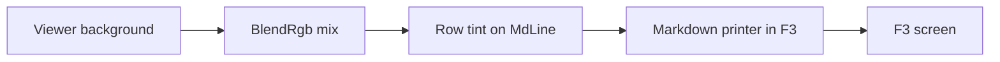

# Gate: Code block tint

_For the owner, who reads this instead of the code. One page per section. The model writes
"Before build" before any task starts, and "At merge" at close-out; both go at the top of the
PR._

## Before build

### What it builds

A code block in F3 gets a background tint, full width, so the block stands apart from the text.
The tint rides every row of the block, past the end of the text, to the right edge.

### Parts it touches



### Contracts, data and runtime

- `MdLine` gains one field: a row-level background tint, drawn to the full row width.
- The tint is a blend of the viewer background and the code color, with `BlendRgb` in
  `far2l/src/filediff.cpp` as the pattern. A true-color check gates it, as in
  `CanUseTrueColorFallback`.
- Contrast: `utils/include/Colorspace.h`. A tint under 3:1 against the code foreground is not
  drawn.
- With `--norgb`, no tint shows, and the text stays readable.
- A theme change alters the tint at the next redraw.
- The tint is compatible with the Colorer fence colors of markdown-colorer-fences: the tint is
  the row background, the tokens carry the foreground and the underline. One does not erase the
  other.
- This is the one exception to "the background is always the viewer background": ADR-004 and the
  invariants state it at close-out.

### Decisions the model made

| Decision | Alternative rejected | Why |
|---|---|---|
| A row-level fill on `MdLine`. | A per-run background. | The block is the unit; the fill reaches the right edge for free. |
| Blend the viewer background with the code color. | A fixed tint value. | The block fits any theme; a theme change recomputes. |
| One contrast gate on (code fg, tint). | Per-token gates. | One answer per redraw. |

### How you'll see it working

Open a `.md` file in F3 from the built app: `../far2l.markdown-code-tint.build/install/
far2l.app/Contents/MacOS/far2l`. A fenced block shows a tinted band to the right edge, and the
band ends with the block. Run with `--norgb`: no tint, the text stays readable.

### A fresh reader's paraphrase

_To fill after the fresh read._

## Flow

flow: tier=full docs=spec,plan design=no orchestrator=yes final=final-reviewer gate=stop
scan=yes verifier=none

## Spend

- Budget: S story. $8 spend, $12 hard stop.
- Last recorded: build start, before the first dispatch; the harness task costs ride on this
  line at close-out.

## Check

```sh
cd /Users/Viachaslau_Kudzinau/Projects/far2l/.worktrees/markdown-code-tint
export BUILD=../far2l.markdown-code-tint.build
cmake -S . -B "$BUILD" -DCMAKE_BUILD_TYPE=RelWithDebInfo -DTESTING=Yes -DUSEWX=No -DCMAKE_OSX_DEPLOYMENT_TARGET=14.0
cmake --build "$BUILD" -j8
sh testing/markdown/ascii-golden.sh && sh testing/markdown/ascii-driver.sh
HIGH_BUILD="$BUILD" sh testing/markdown/highlight-driver.sh
sh testing/markdown/look-driver.sh
(cd testing && pkill -9 -f -- '--test=/tmp/far2l'; sleep 1
 find tests -maxdepth 1 -type s -delete
 for s in tests/*; do [ -S "$s" ] && rm -f "$s"; done
 APP="$PWD/../far2l.markdown-code-tint.build/install/far2l.app/Contents/MacOS/far2l"
 for t in $(ls tests); do o=$(./far2l-smoke-run.sh "$APP" "$t" 2>&1) && echo "$o" | grep -q '\[DONE\]' && echo "PASS $t" || echo "FAIL $t"; done)
```

Every test prints `PASS` (the two known Mac failures allowed), every driver exits 0, and the
story's Done list.

## Plan

| Task | Scope | Depends | Done check |
|---|---|---|---|
| T1 | `MdLine.tint`, the fence builder, `MdCodeTint`, the printer fill, the `tint` driver case | - | `look-driver.sh --case tint` exits 0; the whole look driver is green; the full build exits 0 |
| T2 | The 000d smoke rows: the tinted code cell, the cell past the text, the `--norgb` run | T1 | smoke `000d` PASS with the new rows; the gate's Run-it command: all `PASS` |
| T3 | ADR-004's exception row, the viewer spec, the data view, the invariants | T2 | the four files show the new rows; `check_ste.py` prints nothing |
| T4 | The records commit, the close-out, the pull request | T3 | the records commit exists; the merge shows the story's tip |

## Done

- A `tint` driver case: a code row's cell background equals the blend of the viewer background
  and the code color. A row outside the block keeps the plain background.
- The smoke reads the background of code cells, and of one cell past the end of the text.
- `--norgb`: no tint, the text readable (the smoke run with `--norgb` reads the plain codes).
- A contrast-failure case: a low-contrast pair draws no tint.
- Check: the command above exits 0, all PASS, the two known Mac failures allowed.
- Docs: ADR-004's exception row, the viewer spec, `markdown.data.md`, and the invariants, updated
  in this branch.

## At merge

### What was built

_To fill at close-out: same as "What it builds", plus one paragraph on what the finished thing
does, from the close-out report._

### What changed

_To fill at close-out: the commit list, one line each: what changed, and why._

### Decisions changed during the build

_To fill at close-out: rows of the decision table that moved during the build. If none:
"None of the decision table's rows."_

### What the reviews caught

_To fill at close-out: the one-line summary of each review, for the owner who reads this page
instead of the findings file._

### Run it

Run the Check section above; expect all PASS except the two known Mac failures (`0004-vt-shell`,
`000b-find-file`).

### How to verify

_To fill at close-out: the command or demo, and what you should see._

### Spend

_To fill at close-out: the `check_requests` total, and the money at merge._

## Before build

- At G2-design, the owner reads this page, answers the four questions, and approves.
- The main session records the answers as rulings at the foot of this page.
- G3-plan: the plan.md tasks and scan match this page.
