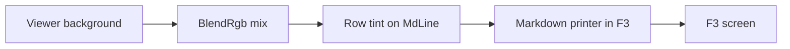

# Gate: Code block tint

_For the owner, who reads this instead of the code. One page per section. The model writes
"Before build" before any task starts, and "At merge" at close-out; both go at the top of the
PR._

## Before build

### What it builds

A code block in F3 gets a background tint, full width, so the block stands apart from the text.
The tint rides every row of the block, past the end of the text, to the right edge.

### Parts it touches



### Contracts, data and runtime

- `MdLine` gains one field: a row-level background tint, drawn to the full row width.
- The tint mixes one eighth of the code color into the viewer background, with `BlendRgb` in
  `far2l/src/filediff.cpp` as the pattern. A true-color check gates it, as in
  `CanUseTrueColorFallback`.
- Contrast: `utils/include/Colorspace.h`. A tint under 3:1 against the code foreground is not
  drawn.
- With `--norgb`, no tint shows, and the text stays readable.
- A theme change alters the tint at the next redraw.
- The tint is compatible with the Colorer fence colors of markdown-colorer-fences: the tint is
  the row background, the tokens carry the foreground and the underline. One does not erase the
  other.
- This is the one exception to "the background is always the viewer background": ADR-004 and the
  invariants state it at close-out.

### Decisions the model made

| Decision | Alternative rejected | Why |
|---|---|---|
| A row-level fill on `MdLine`. | A per-run background. | The block is the unit; the fill reaches the right edge for free. |
| Blend the viewer background with the code color. | A fixed tint value. | The block fits any theme; a theme change recomputes. |
| One contrast gate on (code fg, tint). | Per-token gates. | One answer per redraw. |

### How you'll see it working

Open a `.md` file in F3 from the built app: `../far2l.markdown-code-tint.build/install/
far2l.app/Contents/MacOS/far2l`. A fenced block shows a tinted band to the right edge, and the
band ends with the block. Run with `--norgb`: no tint, the text stays readable.

### A fresh reader's paraphrase

**T1 - The field, the blend, the printer.** `MdLine` gains `int64_t tint = -1`. The fence
builder sets it on the fence's code rows and the hint row. `MdCodeTint(viewer_bg)` blends the
viewer background with the code role's resolved foreground, the pattern of `BlendRgb` in
`far2l/src/filediff.cpp`. True color gates the tint, and 3:1 on (code foreground, tint) gates
it, with `wcagComputeContrast`. One verdict, cached on (viewer background, code color).
`Print` paints the fill for the full row width, before the runs. Driver case `tint`: a code
row's background equals the blend, and a row outside the block is plain. A low-contrast pair
draws no tint; a background change redraws with the new blend.

**T2 - Smoke, `--norgb`.** `000d` reads the javascript fence. A code row's background is the
tint. One cell past the end of the text is the tint, so the fill reaches the right edge. The
row after the block is plain. Read the values from a sweep run, not by guess. The harness runs
16 colors, so assert the code cell's background as the run prints it.

**T3 - Durable docs.** ADR-004 gains the exception row: the block background is the tint, not
the viewer background. The spec's fence row names the tint. The data view names the `MdLine`
field. The invariants gain the tint rule with its contrast gate.

**T4 - Close-out.** The orchestrator writes the close-out draft (the records commit). The main
session fills the gate close-out rows and commits the durable docs. It opens the pull request
into `next/2.9.1-ovr.1`, merges, and pulls into the main checkout.

## Flow

flow: tier=full docs=spec,plan design=no orchestrator=yes final=final-reviewer gate=stop
scan=yes verifier=none

## Spend

- Budget: S story. $8 spend, $12 hard stop.
- Last recorded: build start, before the first dispatch; the harness task costs ride on this
  line at close-out.

## Check

```sh
cd /Users/Viachaslau_Kudzinau/Projects/far2l/.worktrees/markdown-code-tint
export BUILD=$(cd ../far2l.markdown-code-tint.build && pwd)
cmake -S . -B "$BUILD" -DCMAKE_BUILD_TYPE=RelWithDebInfo -DTESTING=Yes -DUSEWX=No -DCMAKE_OSX_DEPLOYMENT_TARGET=14.0
cmake --build "$BUILD" -j8
sh testing/markdown/ascii-golden.sh && sh testing/markdown/ascii-driver.sh
HIGH_BUILD="$BUILD" sh testing/markdown/highlight-driver.sh
LOOK_BUILD="$BUILD" sh testing/markdown/look-driver.sh
(cd testing && pkill -9 -f -- '--test=/tmp/far2l'; sleep 1
 find tests -maxdepth 1 -type s -delete
 for s in tests/*; do [ -S "$s" ] && rm -f "$s"; done
 for t in $(ls tests); do pkill -9 -f -- '--test=/tmp/far2l'; sleep 0.5
  find tests -maxdepth 1 -type s -delete; for s in tests/*; do [ -S "$s" ] && rm -f "$s"; done
  o=$(./far2l-smoke-run.sh "$BUILD/install/far2l.app/Contents/MacOS/far2l" "$t" 2>&1) && echo "$o" | grep -q '\[DONE\]' && echo "PASS $t" || echo "FAIL $t"; done)
```

Every test prints `PASS` (the two known Mac failures allowed), every driver exits 0, and the
story's Done list.

## Plan

| Task | Scope | Depends | Done check |
|---|---|---|---|
| T1 | `MdLine.tint`, the fence builder, `MdCodeTint`, the printer fill, the `tint` driver case | - | `look-driver.sh --case tint` exits 0; the whole look driver is green; the full build exits 0 |
| T2 | The 000d smoke rows: the tinted code cell, the cell past the text, the `--norgb` run | T1 | smoke `000d` PASS with the new rows; the gate's Run-it command: all `PASS` |
| T3 | ADR-004's exception row, the viewer spec, the data view, the invariants | T2 | the four files show the new rows; `check_ste.py` prints nothing |
| T4 | The records commit, the close-out, the pull request | T3 | the records commit exists; the merge shows the story's tip |

## Done

- A `tint` driver case: a code row's cell background equals the blend of the viewer background
  and the code color. A row outside the block keeps the plain background.
- The smoke reads the background of code cells, and of one cell past the end of the text.
- `--norgb`: no tint, the text readable (the smoke run with `--norgb` reads the plain codes).
- A contrast-failure case: a low-contrast pair draws no tint.
- A theme change recolors the block at the next redraw (the driver changes the background).
- Check: every test prints `PASS` under the command above (the two known Mac failures allowed),
  and every driver exits 0.
- Docs: ADR-004's exception row, the viewer spec, `markdown.data.md`, and the invariants, updated
  in this branch.

## At merge

### What was built

A fenced code block in the F3 Markdown view paints a tinted band: every row of the block, from
the first code row to the last (and the hint row under undrawn mermaid art), carries a blended
background to the right edge, also past the end of the text. The tint blends one eighth of the
code role's resolved foreground into the real viewer background, so it fits any theme. It shows
when the terminal reports true color and the pair (code foreground, tint) reaches 3:1; the
verdict is cached on (viewer background, code color) and recomputed on a theme or scheme change.
Runs of the row, token runs included, ride the tint. `--norgb` draws the block without a tint.

### What changed

- `11672d8dc` The `MdLine.tint` field, `MdCodeTint`, the printer's row fill, the `tint` driver
  case: the block is a row property, resolved to the live theme at draw time.
- `459a413b2` Code runs ride the fence tint; the cells past the text keep it: one background
  across the whole row.
- `9d5df9ebb` 000d reads the fence tint, the cell past the text, the right edge, and the
  `--norgb` plain codes.
- `32687c70e` 000e: a 24-row sweep behind the tint, for rows printed after a scroll-in.
- `c2062fcf1` T2 review: code runs ride the tint background, drawn before the fill loses.
- `310db4d08` Final review: a tinted row paints in one pass, runs then tinted tail: rows
  printed after a scroll-in keep one console row per Markdown row.
- `588e909e1` The gap row inside a block rides the fill; 000e rewritten on `far2l -view`, away
  from the panel cursor race.
- `bc084a675` Durable docs: ADR-004's exception, the viewer spec, the data view, the invariants.
- `a7541dffa` The gate check resolves the build path to an absolute one: the harness resolves a
  relative app path from the test folder.

### Decisions changed during the build

The print order moved: a tinted row paints in one pass (runs, then the tinted tail), not the
fill first and the runs over it. The row count per Markdown row is what the smoke measures.

### What the reviews caught

- T1: none beyond the plan.
- T2: code runs were painted under the fill; they ride the tint now.
- T3: the docs rows match the spec and the data view.
- Final review: the fill order; and the gap row inside a fence lost the block background, now
  read in 000d.

### Run it

Run the Check section above; expect all PASS except the two known Mac failures (`0004-vt-shell`,
`000b-find-file`).

### How to verify

Open a `.md` file with a fenced block in F3:
`../far2l.markdown-code-tint.build/install/far2l.app/Contents/MacOS/far2l`. The block shows a
tinted band to the right edge; the band ends with the block. Run with `--norgb`: no tint, the
text stays readable.

### Spend

Story agents about $2.5 (8 dispatches, request-priced; the build ran in the omp harness, where
spend.mjs finds no Claude transcripts). The build used incremental cmake.
## Before build

- At G2-design, the owner reads this page, answers the four questions, and approves.
- The main session records the answers as rulings at the foot of this page.
- G3-plan: the plan.md tasks and scan match this page.
