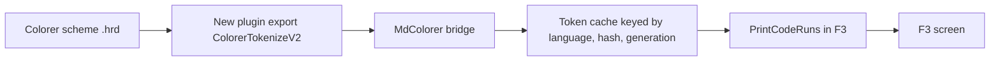

# Gate: Exact Colorer colors in fenced code

_For the owner, who reads this instead of the code. One page per section. The model writes
"Before build" before any task starts, and "At merge" at close-out; both go at the top of the
PR._

## Before build

### What it builds

A fenced code block in F3 shows the same foreground per word as the same code in F4. The active
Colorer scheme colors functions, types, constants, operators and tags, not only keyword, string,
comment and number. The scheme's underline rides the tokens it underlines. A scheme change
recolors the fences.

### Parts it touches



### Contracts, data and runtime

- New plugin export `ColorerTokenizeV2(abi, language, lines, nLines, budget_ms, cells, capacity,
  generation)`: the same input and limits as V1 (32 lines, 256 cells, a deadline in
  milliseconds), and codes -1..-3 as V1. Each cell takes 8 words: start, end, the region's
  foreground `0xRRGGBB`, the scheme's 4-bit foreground, the Colorer style word (bit 4 =
  underline), three zeros. `*generation` carries the scheme generation. The export does not
  create `FarEditorSet`. V1 stays for the old callers.
- An unset color takes the F4 fallback chain: the region, its parents, then `def:Text`.
- A cached fence takes the key (language, fence text hash, scheme generation): a scheme change
  refetches, a resize does not.
- A token range in the core carries a foreground and an underline bit, not a class.
  `PrintCodeRuns` paints the foreground (24-bit, or the 4-bit value on a 16-color console) and
  the underline. A cell with no range keeps the plain code role.
- The 3:1 contrast verdict of markdown-colorer-look decides for the whole view. On a failure,
  fences use the plain code role, and prose the fork table.
- A 20k-line fence renders inside the 40 ms budget; task 4 measures it.

### Decisions the model made

| Decision | Alternative rejected | Why |
|---|---|---|
| V2 returns colors and the style word; the core stores them. | V2 returns region names, and the core resolves them. | The plugin owns the scheme; the core keeps no HRC logic. |
| The cache key gains the scheme generation. | Refetch on every render. | A scheme change repaints; a resize does not re-tokenize. |
| One view-wide 3:1 verdict, keyed (background, generation). | A per-fence verdict. | One answer for prose and fences; one cache. |
| V1 stays, beside V2 in `ColorerExport.cpp`. | Retiring V1 now. | The old callers (the highlight driver, smoke 000c) keep working; the story counts them. |
| The 4-bit path uses the scheme's 4-bit foreground. | Mapping 24-bit colors to the nearest 16. | F4 shows the scheme's 4-bit fg; F3 matches it. |

### How you'll see it working

Open a `.md` file in F3 from the built app: `../far2l.markdown-colorer-fences.build/install/
far2l.app/Contents/MacOS/far2l`. Go down to the javascript fence. The keyword, a function name,
a string, a constant and an operator show the scheme's colors (far2l.hrd: keyword `#00ff00`,
constant `#00ffff`, operator `#c0c0c0`). Press F4 on the same file: the same words carry the
same colors. Change the scheme (F4, Ctrl-F7, pick a scheme, reopen F3): the fences recolor.
`sh testing/markdown/look-driver.sh` prints `DONE`.

### A fresh reader's paraphrase

**T1 - The V2 export.** Add `ColorerTokenizeV2` beside `ColorerTokenizeV1` in
`ColorerExport.cpp`, as a `SHAREDSYMBOL` export. The same input path as V1: catalog, language,
load scheme, tokenize, deadline. Each token resolves its region's foreground and style through
`HrcLibrary::getRegionDefine` for the active scheme. An unset color takes the F4 chain: the
region, its parents, then `def:Text`. Cells are 8 words: start, end, `0xRRGGBB` foreground, the
scheme's 4-bit foreground, the style word, three zeros. `*generation` carries the scheme
generation. Driver cases: `tokens_v2`, `tokens_v2_limits`, `tokens_v2_v1_callers`.

**T2 - The bridge, the cache key, the token group.** Bind V2 once beside the V1 binding. A
missing symbol falls back to V1's classes through the alias table. A cached range carries
`{start, end, fg, fg4, underline}`, not a class. The cache key gains the scheme generation:
(language, hash, generation). Driver case `look_fence_generation`: two generations, the second
render refetches.

**T3 - `PrintCodeRuns` and the view contrast verdict.** The printer paints each range: true
color takes `fg`, else `fg4`; the underline bit rides the span re-apply. A cell with no range
keeps the plain code role. The look's batch verdict is keyed (viewer background, generation)
and decides for the whole
view. On a failure, fences take the plain code role, and prose the fork table. Driver case
`look_fence_contrast`.

**T4 - Smoke, hostile, budget.** The 000d smoke asserts the javascript fence: a keyword cell, a
function cell, a string cell, and the tail. The colors are the console.hrd rows. The fixture
gains a `javascript` fence. `tokens_v2_cost` renders a 20k-line fence inside the budget, and
prints the mean and the worst. The 1 MB hostile fixture stays inside it.

**T5 - Durable docs.** ADR-010 records the V2 contract: colors, the 8-word stride, the
generation key, V1 stays. The viewer spec, the data view and the invariants gain the rows.

**T6 - Close-out.** The orchestrator writes the close-out draft. The main session fills the
gate, opens the pull request into `next/2.9.1-ovr.1`, merges, and runs the check once more.

## Flow

flow: tier=full docs=spec,plan design=no orchestrator=yes final=final-reviewer gate=stop
scan=yes verifier=none

## Spend

- Budget: M story. $15 spend, $20 hard stop.
- Last recorded: build start, before the first dispatch; the harness task costs ride on this
  line at close-out.

## Check

```sh
cd /Users/Viachaslau_Kudzinau/Projects/far2l/.worktrees/markdown-colorer-fences
export BUILD=../far2l.markdown-colorer-fences.build
cmake -S . -B "$BUILD" -DCMAKE_BUILD_TYPE=RelWithDebInfo -DTESTING=Yes -DUSEWX=No -DCMAKE_OSX_DEPLOYMENT_TARGET=14.0
cmake --build "$BUILD" -j8
sh testing/markdown/ascii-golden.sh && sh testing/markdown/ascii-driver.sh
HIGH_BUILD="$BUILD" sh testing/markdown/highlight-driver.sh
sh testing/markdown/look-driver.sh
(cd testing && pkill -9 -f -- '--test=/tmp/far2l'; sleep 1
 find tests -maxdepth 1 -type s -delete
 for s in tests/*; do [ -S "$s" ] && rm -f "$s"; done
 for s in tests/*; do [ -S "$s" ] && rm -f "$s"; done
 APP="$PWD/../far2l.markdown-colorer-fences.build/install/far2l.app/Contents/MacOS/far2l"
 for t in $(ls tests); do o=$(./far2l-smoke-run.sh "$APP" "$t" 2>&1) && echo "$o" | grep -q '\[DONE\]' && echo "PASS $t" || echo "FAIL $t"; done)
```

Every test prints `PASS` (the two known Mac failures allowed), every driver exits 0, and the
story's Done list.

## Plan

| Task | Scope | Depends | Done check |
|---|---|---|---|
| T1 | The V2 export in the plugin, the 8-word cells, the driver scaffold | - | `tokens_v2`, `tokens_v2_limits`, `tokens_v2_v1_callers` exit 0; full build exits 0 |
| T2 | The core bridge, the generation key, the range on the token group | T1 | `look_fence_generation` exits 0; the look driver is green; full build exits 0 |
| T3 | `PrintCodeRuns`, the view-wide contrast verdict | T2 | `look_fence_contrast` exits 0; the look driver is green; smokes `0007`, `000c`, `000d` PASS |
| T4 | The 000d fence cells, the hostile fixture, the cost line | T3 | the gate's Run-it command: all `PASS` (two known Mac failures), cost line printed |
| T5 | ADR-010, the viewer spec, the data view, the invariants | T4 | the four files show the new rows; `check_ste.py` prints nothing |
| T6 | The records commit, the close-out, the pull request | T5 | the records commit exists; the merge shows the story's tip |

## Done

- `ColorerTokenizeV2` answers a javascript fence with a foreground and a style word per token.
  An unset color takes the F4 fallback. Codes -1..-3 and `abi` 1 stay as in V1.
- Driver cases: `tokens_v2`, `tokens_v2_limits`, `tokens_v2_v1_callers`, `tokens_v2_cost`,
  `look_fence_contrast`, `look_fence_generation`.
  `tokens_v2` checks per-word colors against F4 on `far2l.hrd`, and the 4-bit rows on
  console.hrd. `tokens_v2_limits` checks 32 lines, 256 cells, and the deadline.
  `tokens_v2_v1_callers` checks that V1 answers as before. `tokens_v2_cost` renders a 20k-line
  fence inside the budget, and prints the mean and the worst. `look_fence_contrast` checks a
  failing scheme: fences plain code, prose fork, one verdict. `look_fence_generation` checks
  that a generation change refetches the ranges.
- Smoke `000d`: the javascript fence asserts a keyword cell, a function cell, a string cell, and
  the tail. The colors are the console.hrd rows, as the harness runs 16 colors. The truecolor
  rows are the driver's job.
- Colorer missing: every fence is the plain code role.
- The hostile fixture (the 1 MB python fence, many fences, a long line) stays inside the budget.
- Check: the command above exits 0, all PASS, the two known Mac failures allowed.
- Docs: ADR-010, the viewer spec, `markdown.data.md`, the invariants, and this gate, updated in
  this branch.

## At merge

### What was built

_To fill at close-out: same as "What it builds", plus one paragraph on what the finished thing
does, from the close-out report._

### What changed

_To fill at close-out: the commit list, one line each: what changed, and why._

### Decisions changed during the build

_To fill at close-out: rows of the decision table that moved during the build. If none:
"None of the decision table's rows."_

### What the reviews caught

_To fill at close-out: the one-line summary of each review, for the owner who reads this page
instead of the findings file._

### Run it

Run the Check section above; expect all PASS except the two known Mac failures (`0004-vt-shell`,
`000b-find-file`).

### How to verify

_To fill at close-out: the command or demo, and what you should see._

### Spend

_To fill at close-out: the `check_requests` total, and the money at merge._

## Before build

- At G2-design, the owner reads this page, answers the four questions, and approves.
- The main session records the answers as rulings at the foot of this page.
- G3-plan: the plan.md tasks and scan match this page.
