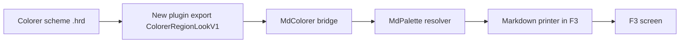

# Gate: Colorer look for Markdown prose

_For the owner, who reads this instead of the code. One page per section. The model writes
"Before build" before any task starts, and "At merge" at close-out; both go at the top of the
PR._

## Before build

### What it builds

The F3 Markdown view colors its prose from the active Colorer scheme, the same colors F4
shows. Headings and links are underlined when the scheme says so. F6 after F4 matches.

### Parts it touches



### Contracts, data and runtime

- New plugin export `ColorerRegionLookV1(abi, names, count, look, capacity, generation)`: the
  look of a list of region names under the active scheme, plus a generation counter. Codes for
  filled, not loaded, disabled, error, bad arguments. The export does not create `FarEditorSet`.
- `FarEditorSet` gains a region-mapper getter and a generation counter, incremented in
  `ReloadBase`. A scheme change in the Colorer settings changes F3 at the next open.
- `MdRunColor` keeps its signature and gains `COMMON_LVB_UNDERSCORE` (0x8000) in the word it
  returns, for the roles the scheme underlines.
- Two new palette roles: `em` (key `emphasis`) and `listmark` (key `listmark`) in
  `settings/markdown-colors.ini`. The resolver order gains one step: user file, Colorer look,
  fork defaults, today's look.
- The core fetches the ten region names at most once per generation, through the same plugin
  module handle the fence tokens use.

### Decisions the model made

| Decision | Alternative rejected | Why |
|---|---|---|
| One new export next to `ColorerRegionLookV1`'s sibling `ColorerTokenizeV1`, four plain arrays. | A shared header struct; a second plugin handle. | Keeps the fork's diff small on both sides. |
| The Colorer look is a resolver step between the user file and the fork table (new ADR-009). | A fixed per-role underline table in the fork. | The scheme decides the underline, so F4 and F6 agree. |
| The underline travels inside the `MdRunColor` word. | A second resolver call per run. | One call site; no extra `stat()` per run. |
| The core asks by region name and maps the name to a role. | Colorer type names, as ADR-008 uses for fences. | Prose regions resolve by name today; no slug work needed. |
| New roles `em` and `listmark`, appended at the end of the role list. | Reuse `body` for both. | Each gets its own ini key; old role numbers do not move. |
| One all-or-none 3:1 batch verdict on the scheme, cached on (background, generation). | Per-role verdicts. | The scheme is chosen as a set; one cache, one rule. |

### How you'll see it working

Open a `.md` file in F3 from the built app: `../far2l.markdown-colorer-look.build/install/
far2l.app/Contents/MacOS/far2l`. Headings and links show `#8888ff` underlined, strong
`#40a000`, emphasis `#ff20a0`, code `#FFE977`, quote `#6699ff`. Press F4 on the same file and
the same words carry the same colors. `sh testing/markdown/look-driver.sh` prints `DONE`.
The underline is visible only in a terminal that draws it; `manual-checks.md` lists the two
terminals to check.

### A fresh reader's paraphrase

Fresh read (scout, 2026-11-07): "T1 builds the plugin export and its driver. The export is
`ColorerRegionLookV1(int abi, const wchar_t* const* names, int count, unsigned int* look,
int capacity, unsigned int* generation)`: `abi` is 1, `look[2*i]` is `0xRRGGBB`, `look[2*i+1]`
is the Colorer style; codes are 0 filled, 1 not loaded, 2 disabled, 3 exception, 4 bad
arguments. Order: check arguments, check `editorSet`, check `GetPluginStatus`/`GetParserFactory`
/`GetRegionMapper`, resolve each name through `getRegion` then the climbing
`getRegionDefine(const Region*)`, write `fore`/`style`, write the generation, return 0; a
Colorer `Exception` announces and returns 3. `FarEditorSet` gains `GetRegionMapper()`,
`GetBaseGeneration()`, `m_baseGeneration = 0` and `++m_baseGeneration` as the last line of
`ReloadBase`, so the first real generation is 1. `CMakeLists.txt:24` gains `MdExport.cpp`. The
driver mirrors `highlight-driver.sh` (`LOOK_BUILD`, `--case`, `ok`/`FAILED`/`DONE`) and runs
`look_first_call`, `look_real_hrd` (ten exact pairs, `0x99EEEE/0` … `0xFFFFFF/0`), and
`look_cost` (1000 fetches, mean in microseconds, to `closeout.md`). T2 adds
`MdRegionLook{fore,style}`, `MdLookSource::Fetch`, `MdGetLookSource` and
`MdSetLookSourceForTest`, sharing one dlopen handle with the token source. T3 adds
`MD_ROLE_EM` (`0xd7d7af`, `F_LIGHTMAGENTA`) and `MD_ROLE_LISTMARK` (`0x8787af`, `F_CYAN`)
at the end of the role list, a `span_em` counter, and a two-run lead split. T4 inserts the
Colorer step between the ini and the fork table, with a generation-keyed look cache and a
`(background, generation)` 3:1 batch verdict; underline means bit `0x8000`. T5 re-applies the
bit with one GetText/PutText pair per row, because `Console::Text` drops it. T6 runs the F4/F6
parity session and the scheme-change session in 000d. T2 owns `MdColorer.*`; T3 and T4 share
`MdPalette.cpp`, in order, no overlap. No done check hides work in a pipe. The export ABI, the
bridge struct, the cache keys, the underline transport, the ten-name list, and the smoke cell
reads are all concrete."

## Flow

flow: tier=full docs=spec,plan design=no orchestrator=yes final=final-reviewer gate=stop
scan=yes verifier=none

## Spend

- Budget: M story. $15 spend, $20 hard stop.

## Check

```sh
cd /Users/Viachaslau_Kudzinau/Projects/far2l/.worktrees/markdown-colorer-look
export BUILD=../far2l.markdown-colorer-look.build
cmake --build "$BUILD" -j8            # far2l and all plugins, once
sh testing/markdown/ascii-golden.sh
sh testing/markdown/ascii-driver.sh
sh testing/markdown/highlight-driver.sh
sh testing/markdown/look-driver.sh
(cd testing && pkill -9 -f -- '--test=/tmp/far2l'; sleep 1
 find tests -maxdepth 1 -type s -delete
 for s in tests/*; do [ -S "$s" ] && rm -f "$s"; done
 for t in $(ls tests); do o=$(./far2l-smoke-run.sh "$PWD/../far2l.markdown-colorer-look.build/install/far2l.app/Contents/MacOS/far2l" "$t" 2>&1) && echo "$o" | grep -q '\[DONE\]' && echo "PASS $t" || echo "FAIL $t"; done)
```

The full build (with the plugins) is part of the check: this story draws its colors from the
Colorer plugin. `0004-vt-shell` and `000b-find-file` fail today, for a reason we do not know.
Any other failure is new.

## Risks

- contract: `ColorerRegionLookV1` is a new export of the Colorer plugin. An old plugin binary
  without it gives the fork table, and the fence tokens keep working.
- contract: `MdRunColor` is the viewer-to-palette seam. It gains the underline bit in the word
  it returns; the signature does not change.
- The underline is visible only in a terminal that draws it (see `manual-checks.md`).

## Plan

| Task | Scope | Depends | Done check |
|---|---|---|---|
| T1 | The plugin export, the `FarEditorSet` accessors, the look driver, and the three measurements | - | `cmake --build "$BUILD" --target colorer -j8 && sh testing/markdown/look-driver.sh --case look_first_call && sh testing/markdown/look-driver.sh --case look_real_hrd && sh testing/markdown/look-driver.sh --case look_cost` exits 0 |
| T2 | The core bridge in `MdColorer`, with the shared module handle and a fake source | T1 | `cmake --build "$BUILD" --target far2l -j8 && sh testing/markdown/look-driver.sh --case look_bridge && sh testing/markdown/look-driver.sh --case look_codes` exits 0 |
| T3 | The `em` and `listmark` roles on the fork path, with the 0007 updates | - | `cmake --build "$BUILD" --target far2l -j8 && sh testing/markdown/look-driver.sh --case look_new_roles` exits 0 |
| T4 | The Colorer step in the resolver, the batch contrast verdict, and the cache | T2, T3 | `cmake --build "$BUILD" --target far2l -j8 && sh testing/markdown/look-driver.sh --case look_roles && sh testing/markdown/look-driver.sh --case look_contrast && sh testing/markdown/look-driver.sh --case look_ini && sh testing/markdown/look-driver.sh --case look_generation` exits 0 |
| T5 | The underline on screen in `MarkdownPrinter`, and the new 000d smoke test | T4 | `000d-view-md-look` prints `[DONE]` with no `FAILED` |
| T6 | The 000d smoke sessions: F4/F6 parity on one file, and a scheme change moving F3 | T5 | `000d-view-md-look` prints `[DONE]` with no `FAILED` |

## At merge

### What was built

_To fill at close-out: against "What it builds": same, more, or less, and why._

### Decisions changed during the build

_To fill at close-out: rows changed or added in the table above, with the reason; or "none"._

### What the reviews caught

_To fill at close-out: the findings that changed code, one line each; or "nothing that changed
code"._

### Run it

_To fill at close-out: the command or demo, and what you should see._
