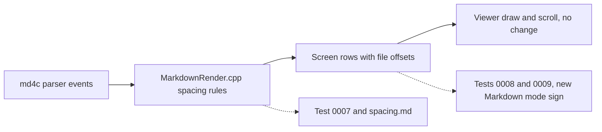

# Gate: markdown-compact-layout

_For the owner, who reads this instead of the code. The model writes "Before build" before any task starts, and "At merge" at close-out. Both go at the top of the PR._

## Before build

### What it builds
The F3 Markdown view shows more text on one screen. Headings lose their rule row, and H2 to H6 lose the blank row after them. Lists lose the blank rows around them, except next to a heading or a code block. Tables lose the top and bottom borders.

A rule row is the line of `═` or `─` under a heading. A blank row is a row with no text. The sign of Markdown mode is what a test reads to know that the view is in Markdown mode.

### Parts it touches

`MarkdownRender.cpp` turns md4c parser events into screen rows. The viewer draws these rows and does not change. The dotted lines are tests.

### Contracts, data and runtime
No data shape, setting, file format or dependency changes. A screen row keeps its fields, and the row offsets stay non-decreasing. The layout contract changes: at close-out, the Rendering and Spacing sections of `markdown-viewer.spec.md` and the offset note in `markdown.data.md` get the new rules.

### Decisions the model made
| Decision | Alternative rejected | Why |
|---|---|---|
| Tests `0008` and `0009` change too. The story named only `0007`. | Keep the story's scope and leave the two tests red. | Both tests are in the check and both use `═` as the sign of Markdown mode. No `═` row stays after this story. |
| In `0008` and `0009` the sign of Markdown mode becomes: the heading shows and `# ` does not. The checks for `═` in plain view go. | Keep the `═` checks in plain view. | Those checks can no longer fail. A check that cannot fail hides a regression. |
| H2 to H6 followed by a code block has no blank row. | Keep a blank row, from the code block rule. | Your words were "no empty lines after ## and ###". The code block rule is the one that was derived. |
| H2 to H6 followed by another heading has one blank row. | No blank row between the two headings. | The story's heading rule has only one exception, the top of the document. |
| A blank row around a list is dropped for a paragraph, quote, table and thematic break. It stays only for a heading or a code block. | Drop it only for a paragraph. | The story's list rule names only those two exceptions. |
| A code block in a list item keeps its blank row when another item follows. Today this row goes. | Keep items tight in all cases. | The story says one blank row after a code block. |
| A heading or a code block as the first block of a list item has no blank row before it. | Apply the blank row there too. | The blank row would split the block from its bullet. |
| An HTML block follows the code block rules. | Treat it as a paragraph. | The viewer already shows it as code. |
| Two kinds of queued blank row: one that a list drops, and one that a list keeps. | Look at the next block when a block ends. | The parser sends events in order, so the next block is not known yet. |
| New blocks go at the end of `spacing.md`, and the test moves by pages. | A new fixture file. | The story names `spacing.md` or `sample.md`. |
| A story `check.sh` deletes stale sockets before each test. | Fix the harness in this story. | Open owner item 11 stops the check in this long worktree path. The harness is out of scope. |

### How you'll see it working
Run `sh docs/stories/markdown-compact-layout/check.sh` from the worktree root. It prints `check ok`. Then press F3 on `testing/tests/0007-view-file-markdown/initdir/left/spacing.md` in the build of this branch, and look at the new `Compact` blocks at the end.

### A fresh reader's paraphrase
_Pasted from the fresh read before the build._

**What this builds**

The F3 Markdown view will show more text on one screen. Headings lose the rule row under them, and H2 to H6 headings lose the blank row after them. Lists lose the blank rows around them. Tables lose their top and bottom borders.

**How the parts fit, per this page**

The md4c parser sends events to MarkdownRender.cpp, which applies the spacing rules and turns them into screen rows that keep their file offsets. The viewer draws and scrolls those rows, and this story does not change it. Test 0007 checks the spacing rules against spacing.md. Tests 0008 and 0009 check the screen rows for the new Markdown mode sign.

## At merge

### What was built
_Written at close-out._

### Decisions changed during the build
_Written at close-out._

### What the reviews caught
_Written at close-out._

### Run it
_Written at close-out._
