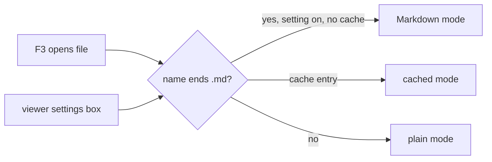

# Gate: F3 on a Markdown file opens the Markdown view by default

## Before build

### What it builds
Pressing F3 on a `.md` or `.markdown` file shows the rendered Markdown at once. Other files open as before. Shift-F4 still switches to plain text, and far2l remembers that choice for that file. A check box in the viewer settings turns the behavior off.

### Terms
- **Markdown mode**: the viewer mode that shows rendered Markdown (Shift-F4 toggles it).
- **Position cache**: far2l's saved place and mode for each file it has viewed.
- **Smoke test**: a script that starts far2l in a fake terminal, presses keys and checks the screen.

### Parts it touches

### Contracts, data and runtime
One new setting `Markdown_Auto` (default on) in the `Viewer` section of the config. One new language string. No file format change.

### Decisions the model made
| Decision | Alternative rejected | Why |
|---|---|---|
| A saved per-file choice wins over the default | Always force Markdown on `.md` | Otherwise Shift-F4 could never keep a file in plain text |
| Non-Markdown files always start plain | Keep inheriting the last file's mode | A text file opening in Markdown mode after a `.md` file is wrong |
| Match by file suffix | Sniff file content | Simple and predictable |
| Files viewed earlier keep their cached mode | Reset the cache | Resetting would also reset positions; the owner can clear it by pressing Shift-F4 once |
| Setting default on | Default off | Owner decision: "it should be on" |

### How you'll see it working
Press F3 on a `.md` file: you see the rendered view. Press F3 on a `.txt` file: plain text.

### A fresh reader's paraphrase
**What this builds.** In far2l's file viewer, F3 on a file named `*.md` or `*.markdown` opens it in Markdown mode at once. Other files open plain, as before. Shift-F4 still switches the mode, and far2l remembers the choice per file. A check box in the viewer settings turns the default off.

**How the parts fit.** The open path picks the starting mode: a saved choice for the file first, then the suffix rule with the setting, then plain. One new config key `Markdown_Auto` (default on) and one new language string. No file format change.

_Settled after the read (details in `plan.md` Rulings):_ the saved choice always wins; the old "inherit the last file's mode" is dropped for the starting mode; a file named exactly `.md` does not match.

## At merge

### What was built
F3 on a `.md` or `.markdown` file opens the rendered Markdown view when the new viewer setting `Markdown_Auto` (default on) is on. Other files open plain. Shift-F4 still switches, and far2l keeps the choice for that file. A check box in the viewer settings turns the default off. Tests 0008 and 0009 cover it; 0007 was adjusted.

### Decisions changed during the build
- The position cache stores only a deviation from the rule (0 = follow the rule, 1 = Markdown by choice, 2 = plain by choice). Turning the check box off now takes effect for every file you did not change by hand.
- A file's old plain entry on a `.md` file (value 0) now follows the rule, so it opens in Markdown. Shift-F4 once keeps plain. This replaces the gate row "Files viewed earlier keep their cached mode" for those files.
- This is a small format change: a far2l build from before this story reads a saved 2 as Markdown.
- `viewer.hpp` got one member (`m_md_rule`).

### What the reviews caught
- Final review 1 (Important): the first cache scheme saved the default as a choice, so the check box did not work for any file you had read. Fixed by the deviation-only scheme.
- Final review 1 (Important): test 0008 could not catch the "inherit the last file's mode" bug. Fixed and mutation-checked.
- Task 2 review (Important): the rule was read at save time; a setting change in Quick View could freeze a default. Fixed by capturing the rule at open.
- Final review 2: Ready for close-out, 0 Critical, 0 Important, 6 Minor (parked in `closeout.md`).

### Run it
Build and run `sh docs/stories/markdown-default-on/check.sh` (tests 0007, 0008, 0009). By hand: press F3 on a `.md` file (rendered), on a `.txt` file (plain), press Shift-F4 on a `.md` file, close and reopen (plain stays). Turn off "Markdown" in Options, Viewer settings: unchanged `.md` files open plain. A `.md` file you read in plain before this change now opens in Markdown; press Shift-F4 once to keep plain.
