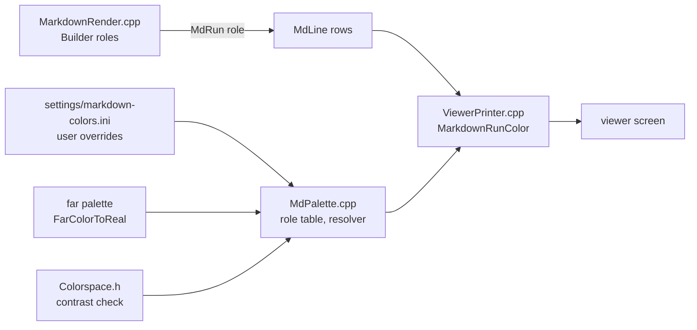

# Gate: Markdown palette

_For the owner, who reads this instead of the code. One page per section. The model writes "Before build" before any task starts, and "At merge" at close-out; both go at the top of the PR._

## Before build

### What it builds

Each Markdown element in the F3 viewer gets its own color: H1 yellow, H2 orange, H3 blue, bold white, links green, code magenta, quotes cyan. Rules and table borders get a muted purple. The colors come from a fork-owned default table. The user can override each one by a value or a palette entry name in `~/.config/far2l/settings/markdown-colors.ini`. Terminals without true color fall back to readable 16-color values. A background with poor contrast falls back to today's look.

### Parts it touches

### Contracts, data and runtime

_Terms: "today's look" is the coloring before this story — the four roles of [ADR-004](../../architecture/decisions/adr-004-palette-roles.md): body, heading, code, art, each mapped to one far palette entry. "Palette entry name" is a name in far2l's color settings (see `ColorsInit` in `far2l/src/console/farcolors.cpp`), resolved to a color at draw time so it follows the theme._

- The `MdRole` enum changes. `MD_ROLE_HEADING` goes away; the roles become body, h1, h2, h3, strong, link, code, quote, rule, art. `MD_ROLE_BODY` stays 0. The enum is internal to the viewer (ADR-004).
- New files `far2l/src/markdown/MdPalette.hpp` / `.cpp` hold the default table and the resolver. `MarkdownRunColor` in `ViewerPrinter.cpp` becomes a small dispatch.
- New read-only settings file `~/.config/far2l/settings/markdown-colors.ini`, section `[markdown]`, one key per role (`body`, `heading1`, `heading2`, `heading3`, `strong`, `link`, `code`, `quote`, `rule`, `art`). Values: an `ExprToFarColor` expression (`foreground:#87AFFF`) or a name with `@` (`@Help.Topic`). far2l reads it and never writes it. A bad value, an unknown name or key, or a missing file changes nothing.
- Resolve order at draw time:
  1. The user file, when it sets the role.
  2. Today's look, when the contrast rule fails.
  3. The RGB defaults, when the palette reports 8 bits or more.
  4. The 16-color fallback.
- The background of every cell stays the viewer background.
- Contrast rule, all or none: each RGB default needs 3.0 or more against the real viewer background (`wcagComputeContrast`). An override has no check.
- Test hook: `testing/far2l-smoke-run.sh` exports `COLORTERM=truecolor`, so the smoke tests reach the RGB path. A `--norgb` case covers the fallback.
- The rendered text and row count do not change. The F5 view, the F4 editor and the browser view do not change.

### Decisions the model made

| Decision | Alternative rejected | Why |
|---|---|---|
| h3 covers H3 to H6 (the story dictates this) — the test asserts H3 to H6 share one color | Six separate colors for H3 to H6 | Out of scope by the story; the owner set H1, H2, H3 only |
| Table header text with no other span takes the strong role, resolved like any run (not a separate header role) | A separate `MD_ROLE_TABLEHEADER` role | The story names strong for header text; a separate role adds an enum value the table has no color for |
| Quote bars (`│ `) take the quote role, not body | Bars stay body like today | The story says "The full lead of a row in a quote has the quote role" |
| Horizontal rules take the rule role (today body), and table borders move from art to rule | Keep borders on art | The story's table names rule for both; the test asserts rule and art differ |
| The user file is read with `KeyFileHelper` and re-read only when its mtime changed; a stat error counts as "no file" | Re-read the file on every draw | Per-call reads are I/O on the draw path; the spec only demands draw-time resolution of theme entries, which stays live |
| The accepted value grammar is exactly `foreground:<value>` or `<value>`, with `<value>` = `#rrggbb`, `#rgb`, an `F_*` name, or `@Name`; no quoted values | Accept the full `ExprToFarColor` grammar | The resolver must tell a bad value from valid black; a narrow grammar it validates itself is the safe way |
| The resolver validates the value syntax itself before `ExprToFarColor`, because that function returns 0 both for a bad value and for valid black | Trust `ExprToFarColor` return alone | A valid black would look like a bad value and silently drop the user's setting |
| Smoke tests get `COLORTERM=truecolor` in the harness wrapper, not a far2l flag | A new far2l flag to force the RGB path | No new surface in the app; `--norgb` already covers the fallback side |

### How you'll see it working

- Open any `.md` file with F3 in the built binary: headings, bold text, links, code, quotes and rules show distinct colors on a true-color terminal.
- Write `heading1=foreground:#00FF00` into `~/.config/far2l/settings/markdown-colors.ini` under `[markdown]`: H1 turns green at the next redraw.
- `sh docs/stories/markdown-palette/check.sh` prints `check ok` (the smoke test `0007` reads the cell colors and asserts the table).

### A fresh reader's paraphrase

> **What this builds** — "The story adds per-element coloring to far2l's F3 file viewer when it displays a Markdown file. Each kind of Markdown text gets its own assigned color, taken from a table of defaults that lives in this fork (not upstream). A user can replace any of those colors by editing a small settings file in their config directory; the file accepts either a raw color expression or the name of an existing far2l palette entry. On terminals that cannot show full 24-bit color the colors degrade to readable 16-color equivalents, and if a chosen color would sit with too little contrast against the viewer's background, the code falls back to the viewer's current, uncolored look instead."
>
> **How the parts fit, per this page** — "While rendering, the Markdown builder tags each run of text with a role from an internal enum (the old single 'heading' role is split into h1/h2/h3, plus roles for strong, link, code, quote, rule and art). At draw time the viewer's printer asks a new palette module what color a role should be. The resolver works through a fixed order: a user override from the ini file wins; otherwise, if the RGB default fails the contrast check against the real viewer background, the 'today's look' palette entry is used; otherwise the RGB default applies when the terminal reports enough colors; and the 16-color fallback is the last resort. Rendering output does not change at all; only foreground colors of Markdown runs do."

## At merge

### What was built

_Pending close-out._

### Decisions changed during the build

_Pending close-out._

### What the reviews caught

_Pending close-out._

### Run it

_Pending close-out._
