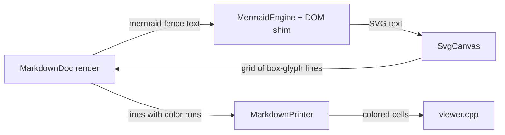

# Gate: F3 Markdown preview — mermaid and colors

## Before build

### What it builds
Fixes the markdown viewer after manual tests. Mermaid fences become box art in macOS Terminal and ghostty. Text, tables and box glyphs use the viewer background, with no black or red blocks.

### Terms
- **MarkdownDoc render**: the code that turns a markdown file into screen lines (`far2l/src/markdown/MarkdownRender.cpp`). It swaps each mermaid fence for the lines that SvgCanvas makes.
- **MermaidEngine**: runs `mermaid.min.js` (the mermaid library) inside quickjs (a small JavaScript runtime built into far2l). It returns SVG text.
- **DOM shim**: a small JavaScript stand-in for the browser page objects that mermaid expects. A missing function in it is why mermaid fails today.
- **SvgCanvas**: draws SVG shapes and text as terminal box glyphs on a cell grid.
- **MarkdownPrinter**: prints those lines to the screen with their colors.
- **Shift-F4**: the key that turns Markdown mode on in the F3 viewer.
- **Test 0007**: the far2l smoke test `testing/tests/0007-view-file-markdown`.
- **Raw-text fallback**: if mermaid fails, the fence stays as plain text.

### Parts it touches

### Contracts, data and runtime
No new contract, file format or dependency. `mermaid.min.js` and quickjs stay as they are. A new test driver, `testing/markdown/`, builds the engine alone.

### Decisions the model made
| Decision | Alternative rejected | Why |
|---|---|---|
| Fix the shim by running the real mermaid bundle and reading each error | Replace the shim with a full DOM library (linkedom or jsdom) | A new dependency needs your approval; the shim is close to working |
| Test the engine with a standalone driver | Debug only inside the TUI | The driver shows the JS error and stack in seconds |
| Combine each run's foreground with the viewer background | Set a new fixed background color | The viewer theme then stays correct |
| Draw all markdown text in the far theme's viewer text color, and show structure by layout | Keep per-element colors (cyan headings, green emphasis) | Your ruling: far theme colors only, no rainbow |
| Keep the raw-text fallback when the engine fails | Show an error banner in the viewer | No behavior change for other users |

### How you'll see it working
Open `testing/tests/0007-view-file-markdown/initdir/left/sample.md` in far2l with F3, press Shift-F4, scroll to the mermaid block.

### A fresh reader's paraphrase
_Pasted from the fresh read before the build._

**What this builds:** The F3 markdown viewer is being fixed after manual testing. Mermaid diagram blocks should appear as box-drawing art in macOS Terminal and ghostty instead of plain text. Ordinary text, tables and box characters should be drawn on the viewer's own background, not show as black or red blocks.

**How the parts fit, per this page:** The markdown render turns a file into screen lines and, for each mermaid block, sends the block's text to MermaidEngine. The engine runs the mermaid library inside quickjs with a small DOM shim and returns SVG text. SvgCanvas draws that SVG as a grid of box-glyph lines, and the render splices those lines in place of the block. The render then passes all lines, with their color runs, to MarkdownPrinter, which prints colored cells into viewer.cpp. If the engine fails, the raw fence text stays on screen.

## At merge

### What was built
As planned. Mermaid fences become box art (flowchart and swimlane-beta checked in test 0007). All markdown runs use the viewer text color of the far theme, so the black and red backgrounds are gone. More than planned: engine time (5 s) and stack limits, and parser limits in SvgCanvas, after the final review. Less than hoped: scrolling with Down and PgDn in Markdown mode is still broken (see closeout.md).

### Decisions changed during the build
- Your color ruling replaced per-element colors with the theme color; structure shows by layout (heading rule, quote prefix, indented code).
- The sample uses `swimlane-beta`, because the bundled mermaid has no alpha grammar.
- One token changed in `viewer.cpp:661` (selection color), because the cause was proved there.
- `testing/src/main.go` got its Environment block back (the baseline commit had dropped it); the net diff against master is empty.

### What the reviews caught
- Stale callbacks and timer errors in the mermaid engine (T1).
- Unbounded CSS matching on hostile SVG (T2).
- Wrong selection color and dead code (T4).
- No time or stack limit on a mermaid render (final review).

### Run it
Open `testing/tests/0007-view-file-markdown/initdir/left/sample.md` with F3, press Shift-F4, press End. You should see the swimlane as box art with Start and Finish, and no black or red blocks. Test: `cd testing && ./far2l-smoke -t 30 ../../far2l.build/install/far2l.app/Contents/MacOS/far2l tests/0007-view-file-markdown` (refresh `workdir` from `initdir` first).
