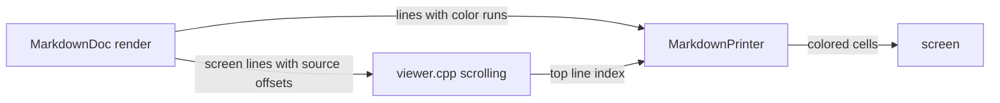

# Gate: Markdown preview — reading experience

## Before build

### What it builds
Makes the Markdown view of the F3 viewer comfortable to read. Down, PgDn, Up, PgUp and the mouse wheel scroll it. Headings and paragraphs get blank lines around them. Headings, code and diagrams get three different colors from your far theme.

### Terms
- **Markdown mode**: the F3 viewer mode that Shift-F4 turns on.
- **MarkdownDoc**: the code that turns markdown into screen lines (`far2l/src/markdown/MarkdownRender.cpp`).
- **Line index scrolling**: the viewer remembers "line number N of the rendered text" as the top of the screen, instead of a byte offset into the file.
- **Theme palette**: the color table that your far2l color theme sets; `COL_VIEWERTEXT` is the normal viewer text color.
- **F3 viewer / Shift-F4**: far2l's file viewer (F3); Shift-F4 switches it between text, hex and Markdown mode.
- **Screen lines**: the lines of text as they appear after rendering, one entry per row. Each carries the byte offset in the source file it came from (its **source offset**).
- **Color runs**: pieces of a line, each with its own color. **MarkdownPrinter** draws them.
- **Position cache**: far2l remembers where you stopped in each file, as a file position.
- **Art**: the third palette role in the spec: mermaid diagrams and table borders.
- **Test 0007**: the smoke test in `testing/tests/0007-view-file-markdown`.

### Parts it touches

### Contracts, data and runtime
No new file format, dependency or runtime. The viewer's position in Markdown mode becomes a line index; the saved position cache still stores a file position, taken from the top line's source offset.

### Decisions the model made
| Decision | Alternative rejected | Why |
|---|---|---|
| Scroll by line index over the rendered lines | Make `Builder::pos` a real file offset and keep byte scrolling | The whole file is rendered at once; line index is simple and cannot blank the screen |
| Use three palette entries (heading, code, art and borders) | One color for everything; or fixed ANSI colors | You asked for readable but not rainbow, in theme colors |
| Blank lines around headings, lists, code, tables, quotes and diagrams | Spacing only after headings | Paragraphs and blocks ran together in your screenshot |

### How you'll see it working
Open `/Users/Viachaslau_Kudzinau/Projects/fde-kb/handbook/situations.md` with F3, press Shift-F4, scroll with Down and PgDn.

### A fresh reader's paraphrase
_Pasted from the fresh read before the build._

**What this builds:** This makes the Markdown view of the F3 viewer comfortable to read. Down, PgDn, Up, PgUp and the mouse wheel scroll it. Headings and paragraphs get blank lines around them. Headings, code and diagrams are drawn in three different colors taken from the user's far theme.

**How the parts fit, per this page:** MarkdownDoc, the renderer, turns the Markdown file into screen lines that carry source offsets and lines that carry color runs. The viewer's scrolling in viewer.cpp keeps the top line index, and MarkdownPrinter draws the colored lines to the screen using that index. The viewer's position in Markdown mode becomes a line index, but the saved position cache still stores a file position, taken from the top line's source offset.

## At merge

### What was built
The Markdown view now scrolls by rendered line (Down, Up, PgDn, PgUp, Home, End, wheel). The status percent and resize follow the line index. Blank lines appear after headings and between paragraphs, lists, code, tables, quotes and diagram art. Headings, code, diagram art and table parts use four palette entries (body, heading, code, art). Table headers use the heading entry and table borders use the art entry. The background is the viewer background. All three tasks match the plan.

### Decisions changed during the build
1. Down stops at the last full page, not at the last line. A review found that the literal rule shows a blank screen. The spec row is not changed yet (owner item 2 in `closeout.md`).
2. Hex mode keys and line-start offsets got a fix round (commit e4d5bdc58).

### What the reviews caught
- T1: hex keys, line-start offsets and the Down limit (fixed in e4d5bdc58).
- T2: spacing inside list items and nested items (fixed in f538ad1d0).
- T3: a table-art test and a table background check (fixed in 4b2e943e3).
- Final review: approved, 0 Critical, 1 Important (long lines are cut, an owner item), 5 Minor.

### Run it
1. Build: `cmake --build ../far2l.build --target far2l -j8`.
2. Run the check from `story.md` (it ends with exit 0).
3. By hand: open `sample.md` with F3, press Shift-F4, then use Down, PgDn, Home and End.
