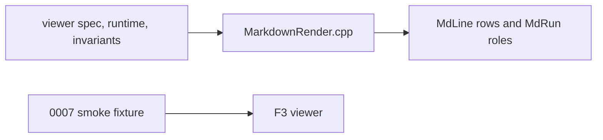

# Gate: markdown-table-fit

## Before build

### What it builds

The F3 Markdown viewer fits every table inside the current viewer width. Long cells grow the table vertically instead of requiring horizontal scrolling.

### Parts it touches

### Contracts, data and runtime

The parser still produces a `rows × cells × MdRun` table model. The layout pass allocates column widths from the available viewer width, including borders and padding. It wraps each cell into visual lines, repeats vertical borders and padding, and emits no trailing spaces. The header and separator remain ordered. Source offsets remain non-decreasing. Resize and F2 re-render the table at the new width.

### Decisions the model made

| Decision | Alternative rejected | Why |
|---|---|---|
| Keep the table as rows, cells, and styled runs until layout | Flatten cells before width allocation | The renderer must preserve code and link roles after wrapping. |
| Add the wide-table case to the existing `0007` fixture | Create a second table smoke harness | The existing harness already checks table borders and roles. |

### How you'll see it working

Build far2l, run the Markdown check from `AGENTS.md`, and open the `0007-view-file-markdown` fixture at an 80-column viewer width. The long cell shows continuation rows, styled inline content keeps its roles, and Right and Left do not reveal more table content.

### A fresh reader's paraphrase

The change keeps parsed table cells and their style runs intact while layout chooses widths that fit the viewer. It wraps words and long words into extra rows, repeats the table borders on those rows, and keeps the header separator in place. The existing Markdown smoke test proves that a wide table shows all content without horizontal scrolling. The three Markdown contract pages describe the new rule.

## At merge

### What was built

The renderer allocates bounded table columns, wraps cells into visual lines, and repeats borders and padding. It preserves cell roles. The `000f` smoke fixture checks whitespace wrapping and splitting an unbroken word.

### Decisions changed during the build

The final review found that the splitter measured characters instead of display cells. The splitter and cell padding now count display cells for full-width characters and combining marks. The fixture retains long-word coverage and checks whitespace wrapping.

### What the reviews caught

The final reviewer approved the display-cell splitter, padding, and wrap tests. The compact-table sizing change also passed independent review. The renderer and `000f` fixture cover table wrapping; `0007` asserts that a narrow table does not expand to the viewer edge.

### Run it

Run the repository Markdown check from `AGENTS.md`. The all-target build, golden and driver checks, and smoke tests `0007`, `0008`, `0009`, and `000f` passed on 2026-11-09.
