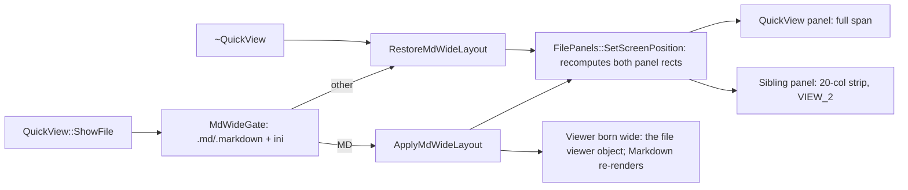

# Gate: md-quick-view-wide

_For the owner, who reads this instead of the code. One page per section. The model writes "Before build" before any task starts, and "At merge" at close-out; both go at the top of the PR._

## Before build

### What it builds

Quick view (Ctrl-Q) on a `.md` file takes the whole screen width; the file list shrinks to a
20-column strip at the far side. Moving to a non-MD file or closing quick view brings the old
split and view mode back. A new setting `Markdown_QuickViewWide` (on by default) switches it off.
The layout uses two panel settings: `ViewSettings.FullScreen` (the panel takes the whole span)
and `Opt.WidthDecrement` (how far the divider between the panels moves from screen centre).

### Parts it touches



### Contracts, data and runtime

- New ini key `Markdown_QuickViewWide` in the viewer section, default 1. Old ini files keep
  working; no migration.
- No public API, plugin API, or file-format changes. New `QuickView` private members and
  private methods only.

### Decisions the model made

| Decision | Alternative rejected | Why |
|---|---|---|
| Full-screen flag on the quick-view panel plus `Opt.WidthDecrement` | Split knob alone (list keeps 2 columns at half width) | One flag gives quick view the full span; the sibling keeps a visible strip; no new geometry code |
| Sibling switches to view mode 2 (two file-name columns) | Add a true one-column mode to the built-in table | Mode 2 fits a 20-column strip; touches no persisted mode table |
| Layout state lives in the `QuickView` object | Store it in `FilePanels` next to `LastLeftFilePanel` (the fields that remember a hidden file panel's state) | State lifetime equals quick-view lifetime exactly |
| Apply and restore only in `ShowFile` and the destructor | Re-evaluate on focus and key events | `ShowFile` is the single choke point for every file shown |
| ini key in the viewer section | Put it in the panel section | It gates a Markdown feature; sits beside `Markdown_Auto` (the existing setting that opens `.md` files in Markdown mode) |
| Smoke test asserts a tail word's screen column | Assert panel border coordinates | The harness is string-plus-position; content proves the render, not just the frame |

### How you'll see it working

Run `.build/install/far2l.app/Contents/MacOS/far2l` from the worktree, open a folder with a
`.md` file, press Ctrl-Q: the file list becomes a narrow strip and the Markdown view spans the
screen. Arrow onto a `.txt` file: the split returns. Machine proof:
The fourth smoke test of the check command in `plan.md` (`far2l-smoke-run.sh` runs the built
far2l against a scripted screen test):

```
cd testing && pkill -9 -f -- '--test=/tmp/far2l'; find tests -maxdepth 1 -type s -delete
./far2l-smoke-run.sh "$(cd .. && pwd)/.build/install/far2l.app/Contents/MacOS/far2l" 000a-view-md-wide
```

### A fresh reader's paraphrase

**What this builds.** In far2l, quick view (Ctrl-Q) normally previews a file in half the screen. This story makes quick view of a Markdown file span the full screen width while the neighboring file list shrinks to a 20-column strip at the far side. Moving to a non-Markdown file, or closing quick view, restores the old split and the previous view mode. A new setting, `Markdown_QuickViewWide` (on by default), turns the behavior off. The layout reuses two existing panel settings — the quick-view panel takes the whole span (`ViewSettings.FullScreen`) and the divider shifts off screen centre by `Opt.WidthDecrement` — so no new geometry code is needed.

**How the parts fit, per this page.** `QuickView::ShowFile` is the single choke point: every file shown passes a gate that checks the `.md`/`.markdown` extension and the ini flag, routing to the apply step (MD) or the restore step (everything else, plus the destructor on close). Both paths end in `FilePanels::SetScreenPosition`, which recomputes both panel rects: the quick-view panel gets the full span, the sibling a 20-column strip in view mode 2 (two NAME columns). The apply path lets the viewer (the F3-style viewer object) be born wide — no resizing a live viewer; Markdown re-renders. Layout state (applied flag, saved sibling view mode, saved width decrement) lives on the `QuickView` object, so its lifetime matches the quick-view's exactly. Everything else is ini plumbing: one new key in the viewer section, default on, old ini files keep working with no migration; no public API, plugin API, or file-format changes.

## At merge

### What was built

Same scope as "What it builds". One build-time refinement: the smoke test proves the restore
phase from the right panel (quick view shows `plain.txt`, content at x 41) and re-applies wide
on the next file; the full-screen quick-view box draws over the sibling strip during one draw
cycle, and the strip returns on the next redraw (cosmetic, close-out ruling 8).

### Decisions changed during the build

None in the decisions table. Rulings 1-4 in `closeout.md` resolved the plan's shorthand to real
APIs (`Opt.ViOpt` is a value member; `CtrlObject->Cp()->GetAnotherPanel(this)`); ruling 7 set
the test's coordinate pair from a real screen run, as the plan authorized.

### What the reviews caught

- T3 review: trimmed `test.js` under 40 lines (commit amended to 3dddc185e).
- Final whole-branch review: Approved, 0 Critical / 0 Important / 1 Minor (fixed); merge risk low.

### Run it

`BUILD=$PWD/.build; APP=$BUILD/install/far2l.app/Contents/MacOS/far2l; ASCII_BUILD=$PWD/.build cmake --build "$BUILD" --target far2l -j8 && sh testing/markdown/ascii-golden.sh && sh testing/markdown/ascii-driver.sh && (cd testing && for t in 0007-view-file-markdown 0008-view-md-default 0009-view-md-setting-off 000a-view-md-wide; do o=$(./far2l-smoke-run.sh "$APP" "$t" 2>&1) && echo "$o" | grep -q '\[DONE\]' && ! echo "$o" | grep -q FAILED || { echo "FAILED: $t"; exit 1; }; done) && echo "check ok"` - prints `check ok`.

Manual: run `$APP`, `Ctrl-Q` on a `.md` file - the list shrinks to a 20-column strip and the Markdown view spans the screen; arrow to a `.txt` - the split returns.
