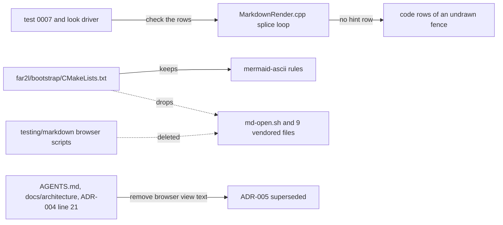

# Gate: md-view-remove

_For the owner, who reads this instead of the code. The model writes "Before build" before any task starts, and "At merge" at close-out. Both go at the top of the PR._

## Before build

### What it builds

far2l loses the Alt-F3 Markdown browser view. This covers the script, nine vendored files, the install rules and the browser tests. far2l no longer names md-view in code or docs. One line in ADR-005 is the exception. A mermaid fence that the terminal cannot draw shows as plain code rows, with no hint row under it.

### Terms

- **md-view:** a separate tool, in its own public repo `https://github.com/slava-kudzinau/md-view`. It now renders a Markdown file to an HTML page in the browser. The owner installs it apart from far2l.
- **Browser view:** the old far2l feature. Alt-F3 on a `.md` file ran `far2l/bootstrap/md-open.sh` through a File associations entry. md-view replaces it.
- **ADR-005:** the decision record `docs/architecture/decisions/adr-005-browser-view-script.md` for the browser view script.
- **Mermaid fence:** a code block in a Markdown file with the info word `mermaid`. F3 draws six diagram types as box art. Other types stay as code.
- **Undrawn fence:** a mermaid fence that F3 cannot draw. Its source shows as code rows.
- **Hint row:** the extra row `(diagram not drawn here - Alt-F3 opens it in the browser)` under an undrawn fence. This story removes it.
- **Test 0007:** the smoke test `testing/tests/0007-view-file-markdown`. It runs far2l headless and reads the screen.
- **Look driver:** the C++ test `testing/markdown/look_driver.cpp`, run by `look-driver.sh`. Its case `tint` checks the code rows of fences.
- **check.sh:** `.build/check.sh`, the story script that runs the check of `AGENTS.md`. It does not run the look driver.

### Parts it touches



### Contracts, data and runtime

- Viewer contract: an undrawn mermaid fence has one row for each source line and no extra row. Before: one more row, the hint, in the body role. The tint, the role and the offsets of the code rows do not change. `markdown-viewer.spec.md` and the `[mermaid]` invariant say this at close-out.
- Build output: no `md-open.sh` and no vendored browser file in the build or the install. The mermaid-ascii files stay in `Resources`.
- Removed: 13 paths (`far2l/bootstrap/`: 10 files; `testing/markdown/`: 2 scripts and 1 folder). The CMake block `Markdown in the browser` (lines 105-126) and the `md-open` filter go too.
- Docs: ADR-005 is `superseded` with one line that names md-view. `markdown-browser-view.spec.md` is deleted. About 15 other doc files lose the browser view text. Nothing else in far2l names md-view.
- Dependency, data, schema and runtime: none new. Some old story folders keep links to the deleted spec. They are history.
- Found by the scout, not in the brief: `testing/markdown/look_driver.cpp` (case `tint`) counts three rows for an undrawn fence. It must count two. The check in `AGENTS.md` does not run it, so the plan runs it by hand.

### Decisions the model made

| Decision | Alternative rejected | Why |
|---|---|---|
| Delete `markdown-browser-view.spec.md` | Keep it with `status: superseded` | The acceptance grep for `md-open`, `md-view.ini` and `browser view` must find nothing outside `docs/stories/` and ADR-005. The spec has about 22 hits. The contract now belongs to the md-view repo. |
| Restore the upstream line `cp "${CMAKE_CURRENT_SOURCE_DIR}/*.sh" "${INSTALL_DIR}"` in `far2l/bootstrap/CMakeLists.txt`, and delete the glob and loop | Keep a plain `foreach` with `list(APPEND)` | The story text "plain list(APPEND)" was the main session's wording for "remove the md-open filter". With the filter gone, the loop copies every `*.sh`, which the one line does too. The upstream line is closer to upstream, so the fork merges with fewer conflicts. |
| Remove `Builder::Fence::lead` and its argument, with the hint row | Keep the member for later | Only the hint row read it. A member that nothing reads is dead code. |
| Fix `look_driver.cpp` (case `tint`) in the same task as the hint row | Leave it, or fix it in a later task | It breaks as soon as the hint row goes. The brief says that no driver depends on the hint, but this driver counts the row. |
| One task for the hint row, test 0007 and the look driver, reviewed as critical | Split the code change from its tests | They are one contract change. Step 2 of T1 runs the new test on the old binary first and records the failure. |
| `AGENTS.md` and the other docs do not name md-view. Only ADR-005 does | A short pointer to md-view in `AGENTS.md` | The owner ruled that far2l has no knowledge of md-view. The one line in ADR-005 is the exception the acceptance grep allows. |
| The docs task is last, with a final review, and edits owner-checked paths. It also edits ADR-004 line 21 | Edit those paths in the main session, or leave ADR-004 stale | The main-session ruling of 2026-11-12 treats the approved story scope as the owner's approval for these doc files. The ruling covers ADR-004 because the acceptance grep requires that edit. |
| Rewrite line 38 of ADR-005 so that it does not quote the hint text | Keep the quote and exclude ADR-005 from the grep for `diagram not drawn` | Main-session ruling F1. Then the acceptance grep for `diagram not drawn` has no exception. |
| Test 0007 asserts `ExpectNoString("not drawn here")` | The string `diagram not drawn` | Acceptance 2 must find that string nowhere outside `docs/stories/`, and the test would be a hit. `not drawn here` is part of the old hint, so the test still fails on the old binary. |
| T2 gets the critical review | The normal review | T2 removes installed files that a File associations entry of a user can call. |
| `markdown.overview.md` gets one sentence: the HTML page view and its spec are not part of far2l, the spec is deleted, the view moved out. It names no tool | Say nothing, or name md-view there | The story says to state the deletion in the overview. The owner ruled that far2l has no knowledge of md-view. |
| Drop the word `browser` from the list of external programs in `views/context.md` | Keep it | far2l opens no web browser itself. |
| The plan gives the exact text of the new lines for ADR-005, ADR-006, the `[mermaid]` invariant, the overview and four `description` values | Leave all new wording to the drafter | These lines carry the contract. Other edits give the meaning only. |
| The `look-driver.sh` case `tint` is a done check of T1 only | Add it to `.build/check.sh` | `check.sh` is the workspace of the story, not a repo file. The look driver is a repo test outside the check. |

### How you'll see it working

```sh
sh .build/check.sh
LOOK_BUILD=.build/out sh testing/markdown/look-driver.sh --case tint
git grep -n -i -E "md-open|md-view\.ini|browser view|MERMAID_HINT|diagram not drawn" -- . ':!docs/stories/' ':!docs/architecture/decisions/adr-005-browser-view-script.md'
```

The first prints `check ok`. The second prints `ok tint`. The third prints nothing. Then run `.build/out/install/far2l.app/Contents/MacOS/far2l`, open a Markdown file with a `swimlane-beta` mermaid fence in F3, and see its code rows with no line below them.

### A fresh reader's paraphrase

_Pasted from the fresh read before the build._

This story removes the Alt-F3 Markdown browser view from far2l. The view runs a script, md-open.sh, and nine vendored files. The story deletes these files, their install rules and the browser tests. A separate tool, md-view, now renders Markdown to an HTML page. far2l no longer names md-view in code or docs. One line in ADR-005 is the exception. A mermaid fence that F3 cannot draw keeps its code rows, and the hint row under it is removed.

The splice loop in MarkdownRender.cpp stops adding the hint row under an undrawn mermaid fence. Test 0007 and the look driver check the code rows of that fence with no hint row. The CMake file keeps the mermaid-ascii rules and drops the install rules for md-open.sh and the nine vendored files. The browser test scripts are deleted. The docs lose the browser view text. ADR-005 is marked superseded and names md-view in one line.

## At merge

### What was built

All of the plan, in four commits on `feat/md-view-remove`:

- T1 `48179eac9`: no hint row under an undrawn mermaid fence. `MERMAID_HINT` and `Builder::Fence::lead` are gone. Test 0007 asserts `ExpectNoString("not drawn here")`. The look driver case `tint` counts two rows.
- T2 `85c327508`: `md-open.sh`, the nine vendored files and the browser test scripts are deleted. The CMake block `Markdown in the browser` and the `md-open` filter are gone. `Resources` holds only `mermaid-ascii.js` and `mermaid-ascii.LICENSE.md`.
- T3 `bf95b3f6e`: the docs. ADR-005 is `superseded` and names md-view in one line. `markdown-browser-view.spec.md` is deleted.
- Fix `0b24ac36f`: the UTF-8 BOM defect row is back in `markdown-viewer.spec.md`.

The diff is 32 files, +71/−9222. The acceptance greps find nothing. md-view is named only in ADR-005.

### Decisions changed during the build

- Acceptance 1 uses reading (a): the grep excludes ADR-005 as a whole. ADR-005 keeps its history text and adds one md-view line.
- Plan line 199 told T3 to delete the UTF-8 BOM defect row. Only its browser view sentence was dead. The final review caught this, and the fix restored the row.

### What the reviews caught

- Final review, Important: the deleted UTF-8 BOM defect row (fixed in `0b24ac36f`).
- Four Minor findings are parked in `closeout.md`. They are about one comment, one test, and one doc line.
- Two smoke tests (`000f-fenceprobe`, `000f-view-md-wrap`) fail on this branch. They fail in the same way on the base commit, so this story did not cause them. `closeout.md` gives the causes.

### Run it

```sh
sh .build/check.sh
LOOK_BUILD=.build/out sh testing/markdown/look-driver.sh --case tint
.build/out/install/far2l.app/Contents/MacOS/far2l
```

The check prints `check ok`. In far2l, open a Markdown file with a `swimlane-beta` mermaid fence in F3. Its code rows show, with no row below them. To get Alt-F3 for Markdown again, install md-view (`https://github.com/slava-kudzinau/md-view`) and add its File associations entry. The release notes of the next far2l package must say this.
