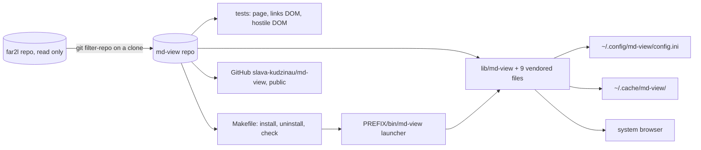

# Gate: md-view-repo

_For the owner, who reads this instead of the code. The model writes "Before build" before any task starts, and "At merge" at close-out. Both go at the top of the PR._

## Before build

### What it builds

A new public repo `md-view` holds the Alt-F3 Markdown browser page as a standalone command, `md-view <file.md>`. The repo keeps the history of the script from far2l. It installs with `make install`. It has its own tests, `AGENTS.md` and docs. far2l does not change in this story.

### Parts it touches



### Contracts, data and runtime

- Command: `md-view` replaces `md-open.sh`. The flags do not change.
- Config: `~/.config/md-view/config.ini`, section `[View]`, same keys. The old far2l file is not read.
- Cache: `~/.cache/md-view/`. The temporary page is `md-view-<pid>.html`.
- Page: the `far2l-md-*` names in the page head and in `localStorage` become `md-view-*`. A reader loses the saved width and theme once.
- Install: `make install PREFIX=...` writes `bin/md-view` and `share/md-view/`. No `DESTDIR`.
- New dependency on this machine: `git-filter-repo` 2.47.0 (Homebrew), for the extract only.

### Decisions the model made

| Decision | Alternative rejected | Why |
|---|---|---|
| Rewrite paths in history (`--path-rename`) to `lib/` and `tests/` | Keep far2l paths and move them in one last commit | `git log lib/md-view` then works with no `--follow`. |
| Run filter-repo on a fresh clone | Run it in the far2l checkout | filter-repo rewrites the repo that it runs in. |
| `bin/md-view` is a launcher that runs `share/md-view/md-view` with `exec` | A symlink in `bin/` | The script finds its vendored files from its own folder, and a symlink breaks that. |
| Vendored files stay beside the script in `lib/` | A `vendor/` folder | No code change in the lookup. |
| Rename the `far2l-md-*` page and storage names | Keep the old names | md-view must not name far2l. |
| License GPL-2.0 | MIT | The script came from far2l, which is GPL-2.0. Only the owner can relicense. |
| `--print-association` keeps only its far2l entry. The `mc.ext` rule is in the README | Remove the option, or add an `mc.ext` block | It is the shortest setup path. A new block is new behavior. |
| The far2l mentions allowed in md-view: README, `AGENTS.md`, `docs/`, the `--print-association` text and its tests, the old-config-path test | No far2l text at all | The far2l setup help and the migration test need the name. |
| Port the hostile-input fixtures and the page rows of the old story check to `tests/hostile-dom.sh` | Leave them in far2l | They are the only security tests of the page. |
| A test with no Chrome or no network prints `skip` and passes | Fail with no Chrome | `make check` must run on a machine with no browser. The skip lines show what did not run. |
| Copy far2l `docs/.templates/` story and ADR templates | No templates | The owner installs `fde-delivery` in md-view next. |

### How you'll see it working

```sh
cd ~/Projects/md-view && make check
make install PREFIX=$HOME/.local && md-view --print-association
```

Add the printed far2l association, then press Alt-F3 on a `.md` file in far2l.

### A fresh reader's paraphrase

_Pasted from the fresh read before the build._

**What this builds**

A new public GitHub repo, `md-view`, holds the Markdown browser page from the far2l Alt-F3 view. It runs as a standalone command: `md-view <file.md>`. The repo keeps the script's history from far2l. A user installs it with `make install`. The repo has its own tests, `AGENTS.md` and docs. far2l does not change in this story.

**How the parts fit, per this page**

The far2l repo is read only. A fresh clone of it goes through `git filter-repo`, which produces the md-view repo. That repo holds `lib/md-view` with 9 vendored files, three test groups, and a Makefile with `install`, `uninstall` and `check` targets. `make install` writes a launcher at `PREFIX/bin/md-view`, and the launcher runs `lib/md-view`. At run time, the command reads `~/.config/md-view/config.ini`, writes to `~/.cache/md-view/`, and opens the page in the system browser.

**Gaps seen (both sections paraphrased; these do not block them)**

- The 9 vendored files are not named.
- The gate does not say what the Markdown browser page renders or how it opens.
- The Contracts list says "same keys" and does not name them.
- "A fresh reader's paraphrase" is still a placeholder.

## At merge

### What was built

The same as planned. `~/Projects/md-view` holds the script as `lib/md-view`, with its far2l history (20 commits, which includes `92a76a055` with a new hash). It also holds the 9 vendored files, four tests, a Makefile and a launcher `bin/md-view`. The docs are a README, GPL-2 `LICENSE`, `AGENTS.md`, an ADR, a spec, invariants and templates. `make check` passes with 169 ok and 0 skip. The installed copy writes the page from any folder. The mermaid diagram draws. far2l did not change.

### Decisions changed during the build

| Decision | Change | Why |
|---|---|---|
| `--print-association` prints an absolute path | The path is now normalized (no `..`) | The final review found `share/md-view/../../bin/md-view` hard to read. |
| `make install PREFIX=...` | A relative `PREFIX`, or a `PREFIX` with a single quote, stops with an error and changes no file | The launcher holds the path in quotes, and a relative path breaks from another folder. |
| `CHROME` override in tests | A bare program name is found on `PATH`. A path that is not executable gives `skip all` | The plan verifier and the final review found the old lookup ran a missing file. |

### What the reviews caught

- T4 (Important): `make install` wrote through a symlink at `$PREFIX/bin/md-view`. Now it writes a temporary file and moves it.
- T4: `make uninstall` failed with a `%` in `PREFIX`. Fixed.
- Final review (Important): the Midnight Commander rule in the README was wrong. It is now `Regex=\\.md$`.
- Final review: the association path was not normalized, and a relative `PREFIX` was accepted. Both fixed.
- 21 Minor findings with no code change are parked in closeout.md.

### Run it

```sh
cd ~/Projects/md-view && make check          # ends with exit 0, no FAIL line
make install PREFIX=$HOME/.local
md-view --print-association                  # prints the far2l entry with the absolute launcher path
```

Add the printed entry in far2l (F9, Commands, File associations). Then press Alt-F3 on `tests/fixtures/diagram.md`. The page opens in the browser, and the flowchart draws.
