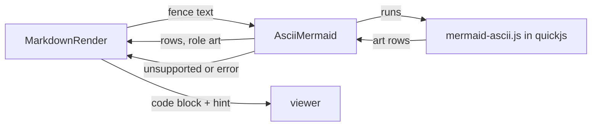

# Gate: ASCII art for diagrams in the terminal Markdown view

## Before build

### What it builds
In the terminal Markdown view (F3, then Shift-F4), mermaid diagrams of six common types appear as clean box art, fast, in your far2l theme color. Other diagram types appear as a code block with a hint to press Alt-F3 for the browser view. The old slow drawing path and the 5 MB library are removed from the terminal view.

### Terms
- **beautiful-mermaid**: an MIT-licensed npm package that turns mermaid text into box-drawing text. It supports flowchart, state, sequence, class, ER and XY charts.
- **Bundle**: its code packed into one small JS file, `mermaid-ascii.js`.
- **quickjs**: the small JS engine already inside far2l.
- **Golden file**: the saved expected art for one sample diagram, made by the package in Node.
- **Alt-F3 browser view**: story B, which opens the whole Markdown file in a web page.

### Parts it touches

### Contracts, data and runtime
New file `far2l/bootstrap/mermaid-ascii.js` (about 100-300 KB), installed with the app. New class `AsciiMermaid`. Deleted: `MermaidEngine`, `SvgCanvas` and the viewer's use of `mermaid.min.js`. Build time needs Node and `npx esbuild` only when you rebuild the bundle. Run time needs neither.

### Decisions the model made
| Decision | Alternative rejected | Why |
|---|---|---|
| Run the package's JS in quickjs | Port it to C++ now | Faster to ship; the golden files let a later port prove it is the same |
| Commit the built bundle | Build it during the far2l build | The far2l build must not need Node |
| One art color for the whole diagram | Colors per part (border, line, text) | Matches the "far theme colors only" rule; simplest |
| Box-drawing characters | Plain ASCII | The viewer already draws box characters well |
| Unsupported type shows code block + hint | Show nothing, or an error | The reader still sees the source and knows where to see the picture |
| Remove the old engine and rasterizer | Keep them as a fallback | Two paths cost more to keep than they give; the browser view is the fallback |
| Stop installing `mermaid.min.js` with the app | Keep installing it | Story B reads the file from the source tree; the terminal no longer needs it |

### How you'll see it working
Open `situations.md` (or any Markdown file with a flowchart) with F3, press Shift-F4, scroll to the diagram. A swimlane block shows its source and the hint line.

### A fresh reader's paraphrase
**What this builds.** In the terminal Markdown view, mermaid diagrams of six types (flowchart, state, sequence, class, entity-relationship, XY chart) are drawn as box-drawing text in the theme color. Other types show as a code block plus a hint to press Alt-F3 for the browser view. The old slow drawing path is removed.

**How the parts fit.** `beautiful-mermaid`'s code is packed into one small JS file, committed and installed with the app. far2l runs it in quickjs through a new class, `AsciiMermaid`. `MarkdownRender` passes it the fence text and gets art rows, or an unsupported or error result. On success the viewer shows the art; otherwise the fence plus the hint. Node and esbuild are only needed to rebuild the bundle. Golden files made by the package in Node are the expected output.

_Settled after the read (details in `plan.md` Rulings):_ the first-word list decides "unsupported"; the hint ships before story B lands; art wider than the screen is cut like code; error texts and the timeout rules are fixed.

## At merge

### What was built
_At close-out._

### Decisions changed during the build
_At close-out._

### What the reviews caught
_At close-out._

### Run it
_At close-out._
