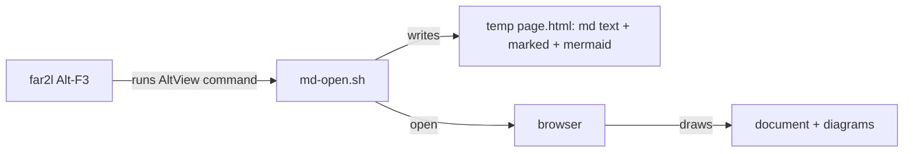

# Gate: Alt-F3 opens a Markdown file as a web page

## Before build

### What it builds
A script. When you press Alt-F3 on a `.md` file, far2l runs it. The script writes one web page that holds your Markdown text and the code to draw it, then opens the page in your browser. Diagrams (mermaid blocks) are drawn by the browser, so every diagram type works. The terminal view (F3, then Shift-F4) does not change.

### Terms
- **Alt-F3**: far2l's "alternative view" key. It runs the `AltView` command of a File associations entry.
- **File associations**: far2l's list of masks (like `*.md`) and the commands to run for them. You edit it in F9, Commands, File associations.
- **marked**: a small MIT-licensed JavaScript library that turns Markdown into HTML.
- **mermaid**: the library that draws diagrams. The page loads it from a CDN.
- **Strict security level**: a mermaid setting that stops diagram text from running scripts.

### Parts it touches

### Contracts, data and runtime
One new script `far2l/bootstrap/md-open.sh`, one vendored file `marked.min.js` (with its license), installed together in the app's Resources folder. Mermaid is loaded from the jsdelivr CDN (pinned version, integrity hash), so the page needs internet to draw diagrams. The text shows at once; without the CDN you see each diagram's source as a code block. The page's content security policy lets it load nothing from the network except that one script, and it blocks remote images: an image link in the Markdown does not load (local images do). A temp file `far2l-md-<pid>.html` stays in the temp folder. Needs a browser opened by macOS `open`. No change to far2l C++ code and no change to your config; you add the association entry once by hand (the script prints it: the Alt-F3 command is `sh <path to md-open.sh> !.!`, unquoted, because far2l escapes the file name itself).

### Decisions the model made
| Decision | Alternative rejected | Why |
|---|---|---|
| A shell script run through File associations | A new C++ viewer key | No C++ needed; Alt-F3 already exists; easy to change |
| Markdown rendered inside the page by `marked` | Convert to HTML in C++ with md4c | Keeps the script small and POSIX; no new native tool |
| One page file; `marked` inline, mermaid from the CDN | A local web server, or the 5 MB mermaid file kept in the repo | Nothing to start or stop; no large file to ship (your decision) |
| Mermaid at strict security level | Loose level | The file may come from anywhere |
| Remote images in the Markdown do not load (a content security policy blocks them) | Load them, so README badges show | The file may come from anywhere; a remote image sends your IP address and the time you opened the file to its host |
| You add the association by hand once (the script prints it) | The script edits your `config.ini` | far2l rewrites `config.ini` on exit and could undo the edit |
| Raw HTML in the Markdown is shown as text | Allow it, or add a sanitizer library | Smallest safe rule; no new dependency |
| Relative links resolve through a `<base href>` to the file's folder | Rewrite every link | One line; no parsing |
| Chrome headless runs in the test | Assert only on the page text | Only a real browser proves the diagram draws |

### How you'll see it working
Run `sh far2l/bootstrap/md-open.sh --print-association`, add that entry in far2l, then press Alt-F3 on a `.md` file. Your browser opens the page with the diagrams drawn.

### A fresh reader's paraphrase
**What this builds.** Alt-F3 on a Markdown file in far2l opens it in your web browser. One new script writes a single self-contained web page (the Markdown text plus the code that renders it) and opens it. The browser draws diagrams, so every diagram type works. The terminal view (F3, then Shift-F4) does not change.

**How the parts fit.** far2l's Alt-F3 runs the `AltView` command of a File associations entry. That command runs `md-open.sh`. The script writes a temp page with the Markdown text, `marked` (Markdown to HTML) and `mermaid` (diagrams), then calls macOS `open`. The script and `marked.min.js` sit together; mermaid comes from the CDN. No C++ or config change is made; you add the association once, with text the script prints.

_Settled after the read (details in `plan.md` Rulings):_ the script shows an error and exits non-zero when a library or the file is missing; raw HTML in the Markdown is shown as text, not run; relative links resolve against the Markdown file's folder; old temp pages are left to the OS to clean; remote images in a Markdown file do not load; the text shows before the CDN script runs, so a slow or blocked CDN never blanks the page; a broken diagram shows its error and its source while the other diagrams still draw.

## At merge

### What was built
_At close-out._

### Decisions changed during the build
_At close-out._

### What the reviews caught
_At close-out._

### Run it
_At close-out._
