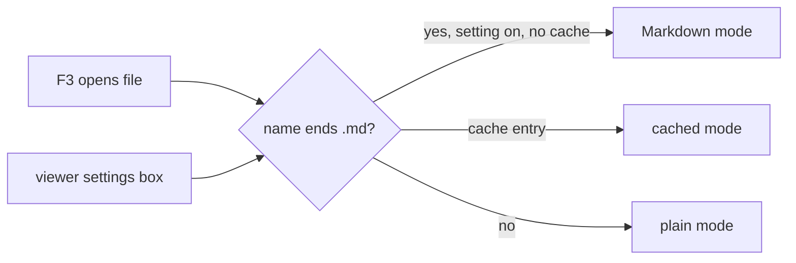

# Gate: F3 on a Markdown file opens the Markdown view by default

## Before build

### What it builds
Pressing F3 on a `.md` or `.markdown` file shows the rendered Markdown at once. Other files open as before. Shift-F4 still switches to plain text, and far2l remembers that choice for that file. A check box in the viewer settings turns the behavior off.

### Terms
- **Markdown mode**: the viewer mode that shows rendered Markdown (Shift-F4 toggles it).
- **Position cache**: far2l's saved place and mode for each file it has viewed.
- **Smoke test**: a script that starts far2l in a fake terminal, presses keys and checks the screen.

### Parts it touches

### Contracts, data and runtime
One new setting `Markdown_Auto` (default on) in the `Viewer` section of the config. One new language string. No file format change.

### Decisions the model made
| Decision | Alternative rejected | Why |
|---|---|---|
| A saved per-file choice wins over the default | Always force Markdown on `.md` | Otherwise Shift-F4 could never keep a file in plain text |
| Non-Markdown files always start plain | Keep inheriting the last file's mode | A text file opening in Markdown mode after a `.md` file is wrong |
| Match by file suffix | Sniff file content | Simple and predictable |
| Files viewed earlier keep their cached mode | Reset the cache | Resetting would also reset positions; the owner can clear it by pressing Shift-F4 once |
| Setting default on | Default off | Owner decision: "it should be on" |

### How you'll see it working
Press F3 on a `.md` file: you see the rendered view. Press F3 on a `.txt` file: plain text.

### A fresh reader's paraphrase
**What this builds.** In far2l's file viewer, F3 on a file named `*.md` or `*.markdown` opens it in Markdown mode at once. Other files open plain, as before. Shift-F4 still switches the mode, and far2l remembers the choice per file. A check box in the viewer settings turns the default off.

**How the parts fit.** The open path picks the starting mode: a saved choice for the file first, then the suffix rule with the setting, then plain. One new config key `Markdown_Auto` (default on) and one new language string. No file format change.

_Settled after the read (details in `plan.md` Rulings):_ the saved choice always wins; the old "inherit the last file's mode" is dropped for the starting mode; a file named exactly `.md` does not match.

## At merge

### What was built
_At close-out._

### Decisions changed during the build
_At close-out._

### What the reviews caught
_At close-out._

### Run it
_At close-out._
