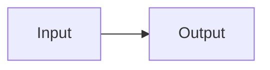

# Heading One

Some *emphasis* and **strong** text with a `code span`.

#### Heading Four

### Heading Three

- bullet one
- bullet two

1. first
2. second

| Col A | Col B | `hcode` |
|-------|-------|---------|
| cell1 | cell2 | x1 |
| cell3 | cell4 | x2 |

```cpp
Code Fence Body
```



```mermaid
swimlane-beta
  subgraph Alpha
    a1[Start] --> a2[Finish]
  end
```

## Heading Two **bold head**

### Heading Three Renamed

##### Heading Five

A <https://example.com> autolink and a [labeled link](https://example.org) here.

A paragraph under a setext-style break
---

> block quote line with **bold quote span** and a `quote code span`

---
